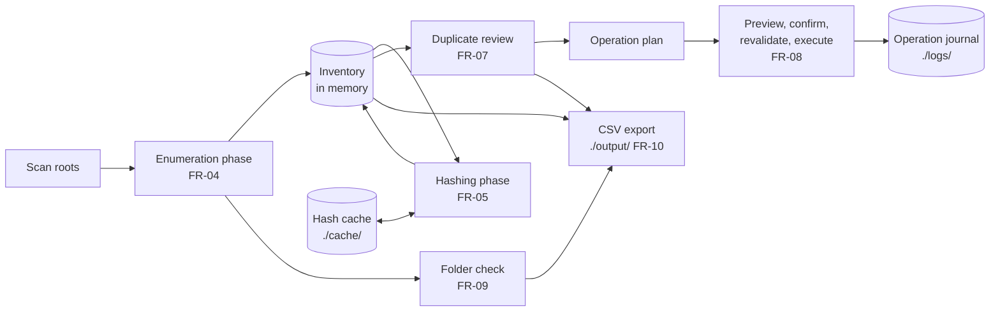
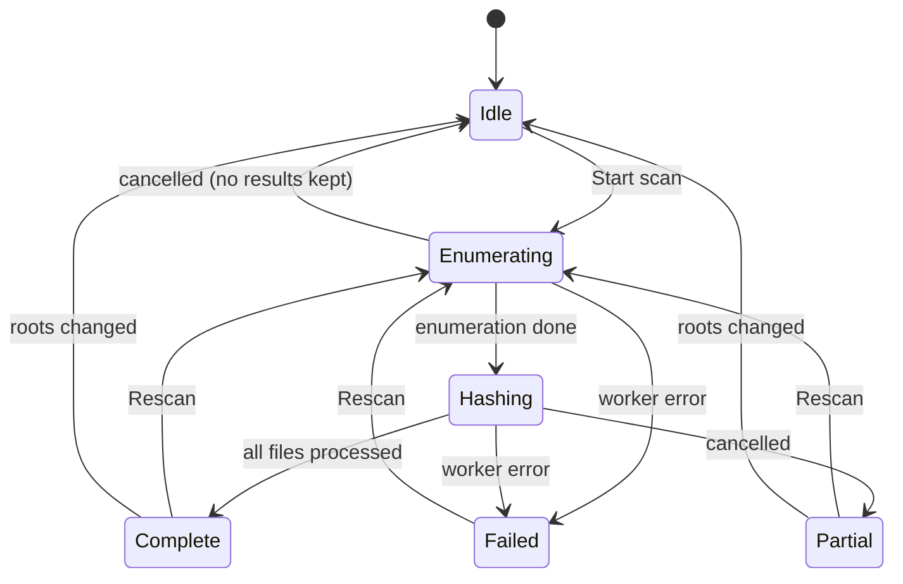
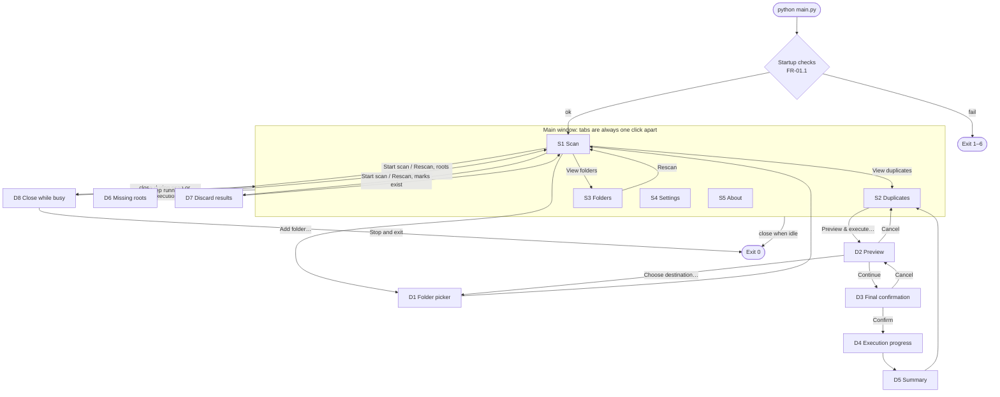
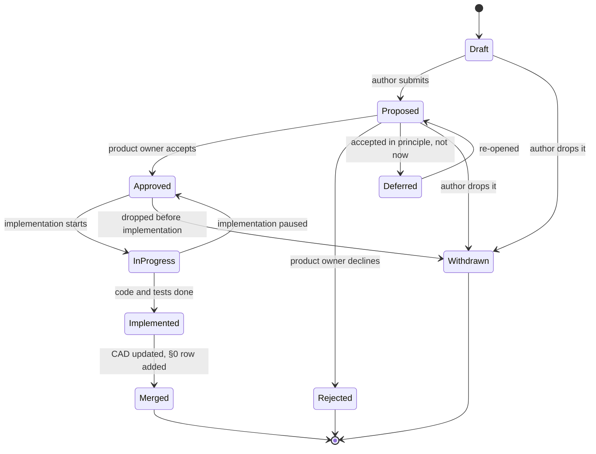

# FileWalker — Folder Inventory, Duplicate Finder & Folder Check Tool (CAD)

**Date:** 2026-11-23
**Author:** Zachary Lin

---

## 0. Document Control

| Version | Revision History | Author | Release Date |
| :-----: | :--------------- | :----: | :----------: |
| V00 | Prototype record. Documents the deployment-risk prototypes that came before this specification and the conclusions drawn from them (§6.3). **C# + WPF:** `dotnet build` succeeded on Windows 11 ARM64, but running the locally built, unsigned exe was refused with "An Application Control policy has blocked this file." The policy type (Smart App Control, WDAC or AppLocker) was not identified, and it is not known whether that machine was a company PC. Conclusion: FileWalker ships **no executable of its own**. **Python + Tkinter:** a single stdlib-only script (`filewalker.py`) run by an installed `python.exe` opened a real Tk window on a Windows 11 ARM64 test PC (Python 3.14.7, Tk 9.0), walked 142,038 files with progress and working Cancel, created no `__pycache__`, skipped 19 legacy junctions, logged 4 `PermissionError` folders and continued, listed paths up to 281 characters, and walked the OneDrive folder after the directory-link check was changed from the generic ReparsePoint attribute to `is_symlink()` / `is_junction()`. Conclusion: Python + Tkinter is the platform. Not verified: anything on a company PC (Python 3.13.14, standard user), the Elevated column, the non-writable-folder path, the three acquisition methods, and OneDrive download behavior. | Zachary Lin | 2026-11-20 |
| V01 | First concept specification of the product. Defines the startup sequence and exit codes (FR-01, Appendix E); the application root with `config/`, `output/`, `logs/` and `cache/` (FR-02), replacing the prototype's flat single-folder layout; multi-root scan sources (FR-03); the traversal engine with cloud-only detection (FR-04); SHA-256 hashing of every file with a persistent hash cache (FR-05); the two-phase scan session (FR-06); duplicate detection and review after the scan (FR-07); file operations with preview, two-step confirmation, revalidation and a journal (FR-08); the folder check view (FR-09); on-demand CSV export (FR-10); English / Traditional Chinese UI following the system language (FR-11); light / dark theme following the system theme (FR-12); settings (FR-13); logging (FR-14); the About page with version and changelog (FR-15); and a reserved, deferred update checker (FR-16). The UI screen catalogue and navigation logic are in Appendix D. Baseline UI toolkit: standard `tkinter` / `tkinter.ttk`. | Zachary Lin | 2026-11-23 |
| V02 | **Plan of Record baseline and change control.** This version is the Plan of Record (POR). Adds Appendix J.2–J.8: the POR definition, four change classes (Editorial, Defect, Finding, Change) and which of them need a Change Request (CR), the CR lifecycle and states, CR files, numbering and the CR index under `dev-ref/cr/`, traceability from CRs to commits, `CHANGELOG.md`, CAD rows and tests, extra rules for safety-relevant CRs, the CR template, and a worked example. Related updates: POR and CR terms in §1.3, CR files in §2.5 and §5.4, CR numbers in `CHANGELOG.md` entries (FR-15.4), and §6.6. No functional requirement changed. | Zachary Lin | 2026-11-24 |
| V03 | **Release and versioning.** Adds Appendix L: the version number format with no pre-release or build suffixes and `filewalker/__init__.py` as the only source of the version (L.1); bump rules for the 0.x phase and after 1.0.0, and the conditions for declaring 1.0.0 (L.2); `schema_version` rules for every persisted format, including migration of older files and handling of newer ones (L.3); the release procedure with who does each step, where Git and GitHub operations are performed by the product owner and not by AI assistants (L.4); the hotfix path (L.5); the release verification record (L.6); and the `.gitignore` rules (L.7). Related updates: release terms in §1.3; `dev-ref/releases/` in §2.5 and §5.4; version and changelog rules in FR-15.1 and FR-15.4; a `schema_version` field on the journal's `plan_started` record (FR-08.8, A.3); TC-15-02 to TC-15-04; §6.5; a "Released in" field for CRs (J.4, J.5, J.7); open issue OI-14. Changes to the change-control or release process are class F (J.3) and need no CR. No functional requirement other than the FR-08.8 and FR-15 details above changed. Merged into V03 before review, after the repository was inspected: GitHub releases attach a zip (L.4.1, TC-15-05, open issue OI-15); the existing `LICENSE` is MIT, which closes OI-11 (Appendix K, S5, L.2); the existing `.gitignore` and the `dev_log/` folder are recorded in L.7 (TC-15-06); the `README.md` placeholder is noted in §2.5. | Zachary Lin | 2026-11-24 |

**Document status:** Concept / Draft for implementation.
**Normative language:** **MUST** / **MUST NOT** mean mandatory requirements, **SHOULD** means recommended, and **MAY** means optional. Items marked **[ASSUMPTION]** have to be checked on a real Windows machine before implementation is final (see Appendix I). Items marked **(hard)** are constraints that no feature may break.

---

## 1. Introduction

### 1.1 Purpose

This document specifies the concept architecture of **FileWalker**, a Windows desktop application written in Python with a Tkinter user interface. FileWalker walks one or more folder trees, records every file with its SHA-256 hash, finds files with identical content, and lets the user decide what to do with them. It also shows, in one list, whether each folder under the scanned roots holds any files.

The project has two motivating use cases:

- **Duplicate consolidation.** The organization keeps files in several Microsoft OneDrive storages, and identical files are scattered across different folders. The duplicates waste storage. The plan is to sync every OneDrive folder to one PC, download the files locally, scan all folders with FileWalker, hash every file, find identical files, and decide how to handle each group (move, delete or skip).
- **Folder check.** Several suppliers manufacture the same product model, and each supplier writes its own specification document against the public requirements and stores it in that supplier's folder. The user needs to see in one screen whether each folder contains files, without opening every folder by hand.

FileWalker is not limited to OneDrive. It works on any local folder.

The document is the single source of truth for implementation, review, and verification. Every functional and non-functional requirement carries an identifier (FR-xx / NFR-xx) with acceptance criteria that Section 6 traces to test cases.

### 1.2 Scope

**In scope**

- Selection of one or more scan roots (local folders, including OneDrive-synced folders).
- Iterative traversal of every folder and file under the roots, skipping directory symlinks and junctions, and continuing past folders that cannot be read.
- Detection of cloud-only (not downloaded) files. They are listed and flagged, never read, so FileWalker never triggers a download.
- SHA-256 hashing of every locally available file, with a persistent hash cache so unchanged files are not read again.
- Duplicate detection by hash after the scan has finished, with a review screen where the user marks each file Keep, Delete, Move or Skip.
- Execution of the marked operations after a preview and a two-step confirmation, with revalidation of every file right before it is touched and an append-only operation journal.
- A folder check list showing, for every folder, its direct and total file counts and whether it is empty.
- On-demand CSV export of the inventory, the duplicate groups and the folder check list.
- A user interface in English and Traditional Chinese (Taiwan), following the system language by default, extensible with more language packs.
- Light and dark themes, following the system theme by default.
- Self-contained storage: settings, outputs, logs and caches live in fixed folders under the application root.
- An About page with the application version, environment information and the changelog.

**Out of scope (V01)**

- Downloading cloud-only files, or any other interaction with the OneDrive client or its APIs. Downloading is the user's job, and the user judges whether there is enough disk space.
- Network access of any kind (NFR-01). The update checker (FR-16) is reserved and deferred.
- Sending files to the Recycle Bin. "Delete" means permanent deletion (FR-08).
- Automatic decisions: FileWalker never deletes or moves a file the user has not marked and confirmed.
- Content comparison other than SHA-256 (fuzzy matching, similar images, file-name similarity).
- Packaging into an executable, installers, code signing, and CI.
- A command-line or headless mode.
- macOS and Linux as deployment targets. They MAY be used for development (§2.3).
- Third-party Python packages (§2.4).

### 1.3 Definitions and Acronyms

| Term | Definition |
| :--- | :--- |
| **Application root** (`./`) | The folder that contains `main.py`. Every file FileWalker writes lives under it (FR-02). |
| **Scan root** | A folder the user adds to the scan list. A scan walks every scan root. |
| **Scan session** | One run of the scan pipeline over the current scan roots: the enumeration phase, then the hashing phase (FR-06). Its results live in memory until the next scan or until the application closes. |
| **Enumeration phase** | Phase 1 of a scan: walking the folder trees and recording folders and files with their metadata (FR-04). |
| **Hashing phase** | Phase 2 of a scan: computing or looking up the SHA-256 hash of every locally available file (FR-05). |
| **Inventory** | The list of all files found in a scan session, with path, size, modification time, status and hash. |
| **Cloud-only file** | A file whose content is not on the local disk (an OneDrive "online-only" placeholder or any file with the recall or offline attributes, A-03). Reading it would start a download. |
| **Hydration** | Downloading the content of a cloud-only file to the local disk. FileWalker MUST NOT cause hydration. |
| **Directory link** | A directory symlink or an NTFS junction. Directory links are never followed (FR-04.3). |
| **Reparse point** | An NTFS attribute used by symlinks, junctions, OneDrive folders and placeholders, and other features. Having it does not make a folder a directory link. |
| **Hash cache** | The SQLite database in `./cache/` that maps a file's path, size and modification time to its SHA-256 digest (FR-05.4). |
| **Duplicate group** | Two or more files in one scan session with the same size and the same SHA-256 digest (FR-07.1). |
| **Keeper** | A file in a duplicate group marked **Keep**. |
| **Reclaimable bytes** | For a duplicate group, `size × (number of files − 1)`. |
| **Mark** | The planned action for one file in a duplicate group: Keep, Delete, Move or Skip (FR-07.4). |
| **Operation plan** | The set of Delete and Move marks the user submits for execution (FR-08.1). |
| **Revalidation** | The checks run immediately before each operation to confirm the file and its group's keeper are still as scanned (FR-08.5). |
| **Operation journal** | The append-only JSON Lines file in `./logs/` that records every planned and executed operation (FR-08.8). |
| **Folder check** | The list of every folder under the scan roots with its file counts and status (FR-09). |
| **Language pack** | A JSON file with every UI string for one language (FR-11). |
| **CAD** | Concept Architecture Document (this document). |
| **POR** | Plan of Record: the latest CAD version plus the CR register; the approved baseline (Appendix J.2). Set at V02. |
| **CR** | Change Request: a numbered, recorded proposal to change the POR, required for class C changes (Appendix J.3–J.7). |
| **Release** | A numbered application version (`MAJOR.MINOR.PATCH`) that has passed the release procedure of Appendix L.4, with its section in `CHANGELOG.md` and its verification record. |
| **Hotfix** | A PATCH release made only to fix an S1 or S2 defect in the latest release (Appendix L.5). |
| **UI** | User interface. |
| **UTC** | Coordinated Universal Time. All stored timestamps are ISO 8601 UTC, for example `2026-11-23T15:40:00Z`. |
| **HIL** | Hardware-in-the-loop: manual tests on a real Windows machine. |

---

## 2. Overall Description

### 2.1 Product Perspective

FileWalker is a standalone desktop application. It has no server, no account, and no installer. It runs as Python source files launched by an already installed `python.exe`, because the V00 prototypes showed that a locally built, unsigned executable is refused by Application Control while a script run by the installed Python is not (§6.3).

**Layers**

```text
main.py                      Entry point: Python version check, bytecode off, startup sequence (FR-01)
filewalker/
  app/                       Composition, paths, settings, logging, i18n, theme detection, platform calls
  core/                      Scanner, hasher, hash cache, duplicates, folder check, operations, export
                             (no tkinter import; testable without a display)
  ui/                        Tk main window, views (S1–S5), dialogs (D1–D8), theme styling
  locales/                   Shipped language packs (en.json, zh-TW.json)
```

- `filewalker/core/` MUST NOT import `tkinter`. It reports progress through callbacks and plain data classes, so it can be unit-tested on any operating system.
- `filewalker/app/platform.py` is the only module allowed to import `ctypes`, `winreg` or `msvcrt` (§2.4 constraint 6).
- Only the Tk main thread touches widgets. Worker threads talk to the UI through a `queue.Queue` that the main thread polls every 100 ms with `after()`, the pattern the V00 prototype validated.

**Data flow**



**Threads**

| Thread | Owns | Talks to |
| :--- | :--- | :--- |
| Tk main thread | All widgets, the UI state, the settings object | Polls the event queue every 100 ms. |
| Scan coordinator (one per scan session) | The traversal, the hash cache connection, the inventory being built | Posts progress and phase events to the queue; submits hashing jobs to the pool. |
| Hash workers (`ThreadPoolExecutor`, size from settings) | Reading file content and computing SHA-256 | Return results to the coordinator only. They never touch the cache or the UI. |
| Operation executor (one per execution) | Revalidation and the file operations of one plan | Posts progress to the queue; appends to the journal. |

### 2.2 User Classes

| User Class | Characteristics | Primary Capabilities |
| :--- | :--- | :--- |
| **Operator (primary)** | The project owner, using FileWalker on their own PC first. Technically comfortable; runs `python main.py` from a terminal. | Add scan roots, scan, review duplicates, plan and execute operations, check folders, export CSV, change language and theme. |
| **Colleague (later)** | A non-technical user in the same organization, after FileWalker is packaged for others (FW-03). Expects a clear UI and safe defaults. | The same as the Operator. Depends on clear warnings before destructive actions. |
| **Maintainer / Developer** | Develops FileWalker, mostly with AI coding assistants, on macOS or Windows. | Implements against this CAD, runs the unit tests, runs the HIL checklist on Windows, maintains the changelog. |

### 2.3 Operating Environment

| Dimension | Requirement |
| :--- | :--- |
| **Operating system** | Windows 11. The V00 Python prototype ran on Windows 11 build 10.0.26300. Windows 10 is not a target. |
| **CPU architecture** | x64 and ARM64. FileWalker is pure Python, so it runs on whichever architecture the installed CPython uses. The V00 prototype ran on ARM64 only; x64 is untested. |
| **Python** | CPython **3.12 or later** (`os.DirEntry.is_junction()` needs 3.12). The company PCs are reported to have Python 3.13.14 with working Tkinter **[ASSUMPTION A-01]**. The V00 prototype ran on Python 3.14.7. No virtual environment and no `pip install`. |
| **Tk** | The Tk bundled with the installed Python: Tk 8.6 with Python 3.13 on Windows, Tk 9.0 observed with Python 3.14.7. FileWalker MUST work with both. |
| **Privileges** | Standard user. FileWalker never requests elevation (NFR-02). |
| **Launch** | `python main.py` from a terminal opened in the application root. Whether `py`, `pythonw` or double-clicking works for a standard user on a company PC is unknown (OI-13). |
| **Disk** | The application root MUST be in a user-writable folder (for example under `Documents`). `C:\Program Files` is not supported, because FileWalker writes under its root. Space for the hash cache: roughly a few hundred bytes per file (estimate, not measured). |
| **Display** | 100%–200% scaling. Legibility at scaling above 100% is untested (OI-09). |
| **Network** | None (NFR-01). |
| **Development** | macOS or Linux MAY run the unit tests and MAY start the GUI for development. Windows-only features (cloud-only detection, theme and language detection, dark title bar, single-instance lock) fall back to neutral defaults there, and nothing on those platforms counts as verification. |

### 2.4 Design & Implementation Constraints

1. **Standard library only (hard).** The runtime uses only the CPython standard library, including `tkinter`, `tkinter.ttk`, `sqlite3`, `hashlib`, `ctypes` and `winreg`. No third-party package is imported, vendored or installed. The baseline UI toolkit is `tkinter` / `tkinter.ttk`. Development tools follow the same rule: tests use `unittest`.
2. **No executable of our own (hard).** FileWalker is never packaged into an exe (PyInstaller, Nuitka, cx_Freeze, py2exe or similar) and ships no DLL. V00 showed that a locally built, unsigned exe is refused by Application Control.
3. **Standard user, no elevation (hard).** No UAC prompt, no `runas`, no `ShellExecute` with admin verbs, no manifest, no scheduled task, no service.
4. **Self-contained storage (hard).** FileWalker writes only inside `./config/`, `./output/`, `./logs/` and `./cache/` under the application root, plus the move destinations the user chooses for Move operations (FR-08.7). It MUST NOT write to `%APPDATA%`, `%LOCALAPPDATA%`, `%TEMP%`, the registry, or `Program Files`. Temporary files go to `./cache/tmp/` (`tempfile.tempdir` is set to it at startup).
5. **No bytecode files (hard).** `main.py` sets `sys.dont_write_bytecode = True` before importing anything from `filewalker/`, so no `__pycache__` folder appears anywhere.
6. **Confined platform calls.** Every Windows API call through `ctypes`, every registry read through `winreg`, and the `msvcrt` lock live in `filewalker/app/platform.py`. The registry is read-only. The allowed calls are listed in FR-11.3, FR-12.2, FR-12.4 and FR-02.5.
7. **Read-only scanning (hard).** The enumeration and hashing phases open files read-only and never change a file, its attributes or its timestamps. Files change only through confirmed operations (FR-08).
8. **No hydration (hard).** FileWalker never reads the content of a cloud-only file (FR-04.4).
9. **No network (hard).** See NFR-01.
10. **Language rules.** Code, identifiers and comments are in English. Every user-visible string comes from a language pack (FR-11). This document is in English.
11. **Single instance.** One FileWalker process per application root (FR-02.5), so two processes never write the same hash cache or journal.
12. **Path comparison.** Paths are compared after `os.path.normcase(os.path.abspath(p))`, because Windows paths are case-insensitive. Paths are stored and shown as the file system reports them.
13. **Coding standards.** Python type hints throughout, `dataclasses` for data records, no global mutable state outside the composition root (`filewalker/app/composition.py`).

### 2.5 User Documentation

| Artifact | Location | Audience |
| :--- | :--- | :--- |
| `README.md` | `./README.md` | All users. What FileWalker does, requirements, how to start it, the folder layout, safety notes on Delete and Move, the downgrade note (L.3 rule 4), and how to use the release zip (L.4.1). The repository holds a placeholder (the title line only); the content is written with the first implementation. |
| `CHANGELOG.md` | `./CHANGELOG.md` | All users. Shown on the About page (FR-15). |
| This CAD | `./dev-ref/CONCEPT_ARCHITECTURE_DOCUMENT.md` | Maintainers and AI assistants. |
| Change Requests | `./dev-ref/cr/CR-INDEX.md`, `CR-TEMPLATE.md`, `CR-<nnnn>-<slug>.md` | Product owner and maintainers (Appendix J). |
| Release records | `./dev-ref/releases/<x.y.z>.md` | Product owner and maintainers: what was verified, where, and the known issues of each release (Appendix L.6). |
| `CLAUDE.md` | `./CLAUDE.md` | AI coding assistants. Points to this CAD, repeats the hard constraints of §2.4, and states that assistants may draft CRs but never approve or implement an unapproved one (J.2). |
| In-app text | Labels, tooltips and dialog messages from the language packs | All users. Destructive dialogs explain what will happen in plain words (FR-08.3). |

### 2.6 Assumptions & Dependencies

**Assumptions**

- **A-01:** The company PCs have CPython 3.13.14 with working Tkinter (reported by the user from an earlier internal project). FileWalker itself has not run there.
- **A-02:** On a company PC, Application Control allows the installed `python.exe` to run `.py` files from a user folder. This held on the V00 test PC, which is not known to be a company PC.
- **A-03:** A cloud-only OneDrive file can be recognized from its file attributes as reported by directory enumeration: `FILE_ATTRIBUTE_RECALL_ON_DATA_ACCESS` (`0x00400000`), `FILE_ATTRIBUTE_RECALL_ON_OPEN` (`0x00040000`) or `FILE_ATTRIBUTE_OFFLINE` (`0x00001000`). Not verified.
- **A-04:** Enumerating a OneDrive folder and reading attributes, size and timestamps through `os.scandir` does not hydrate files. Not measured in V00.
- **A-05:** The size reported for a cloud-only file is its logical size, not its local disk use. V00 saw 16,473 OneDrive files whose sizes add up to about 737 GB on a PC where that much space was unlikely to be in use. Not verified.
- **A-06:** Paths longer than 260 characters can be listed (V00: up to 281 characters on the test PC). Whether they can also be opened, hashed, deleted and moved without the `\\?\` prefix, and whether this depends on the Windows long-path setting, is unknown. FileWalker MUST NOT change that setting.
- **A-07:** The `sqlite3` module is present in the company's Python installation. The standard Windows installer includes it; not checked on a company PC.
- **A-08:** A file's size and modification time (`st_mtime_ns`) change whenever its content changes, so they are a sufficient cache key together with the path (FR-05.4). A tool that rewrites content and restores the old timestamp would defeat this; FileWalker accepts that risk.
- **A-09:** `ttk.Treeview` stays usable with the expected list sizes (about 150,000 inventory rows; duplicate and folder lists of tens of thousands of rows). Not measured.
- **A-10:** The Windows app theme can be read from `HKCU\Software\Microsoft\Windows\CurrentVersion\Themes\Personalize`, value `AppsUseLightTheme` (DWORD, 0 = dark), and the UI language from `GetUserDefaultUILanguage`.
- **A-11:** Permanently deleting a file inside a OneDrive-synced folder also deletes it from OneDrive in the cloud once the client syncs. Whether OneDrive keeps it in its own online recycle bin depends on the tenant's configuration and is not verified. The confirmation dialog warns about this (FR-08.3).

**Runtime dependencies** (full register with licenses in Appendix F)

| Module | Role |
| :--- | :--- |
| `tkinter`, `tkinter.ttk`, `tkinter.filedialog`, `tkinter.messagebox` | GUI. |
| `os`, `stat`, `pathlib`, `shutil` | Traversal, metadata, file operations. |
| `hashlib` | SHA-256. |
| `sqlite3` | Hash cache. |
| `threading`, `queue`, `concurrent.futures` | Worker threads and UI messaging. |
| `json` | Settings, language packs, operation journal. |
| `csv` | Export. |
| `logging`, `logging.handlers` | Application log with rotation. |
| `ctypes`, `winreg`, `msvcrt` | Windows platform calls, read-only registry, instance lock (`app/platform.py` only). |
| `subprocess` | Starting Windows Explorer with an argument list to show a file (`app/platform.py` only, Appendix G). |
| `locale`, `datetime`, `platform`, `sys`, `tempfile`, `dataclasses`, `enum`, `typing` | Support. |

**External dependencies:** the installed CPython and its bundled Tcl/Tk; Windows 11; optionally the OneDrive client, which the user runs and which FileWalker never calls.

---

## 3. Functional Requirements

Every functional requirement follows this structure:

- **Description:** what the capability is.
- **Specification:** numbered, normative sub-requirements (FR-xx.n).
- **Error handling:** defined behavior when the capability fails.
- **Acceptance:** verifiable criteria, traced in §6.2.

### FR-01 — Startup Sequence & Exit Codes

- **Description:** A fixed startup order that checks the environment before any window opens, and a defined process exit code for every way FileWalker can end.

**Specification**

- **FR-01.1 Order.** `main.py` runs these steps in order and stops at the first failure with the exit code shown (full table in Appendix E):

| Step | Check or action | On failure |
| :--: | :--- | :--- |
| 1 | Python version is 3.12 or later. This check is written in syntax that older Python versions can parse. | Message to stderr; exit **3**. |
| 2 | `sys.dont_write_bytecode = True`, then import the `filewalker` package. | — |
| 3 | No command-line arguments were given (`sys.argv[1:]` is empty). | Usage message to stderr; exit **2**. |
| 4 | `import tkinter` succeeds and a `Tk()` root can be created. | Message to stderr; exit **4**. |
| 5 | Resolve the application root and prepare `config/`, `output/`, `logs/`, `cache/` and `cache/tmp/` with a write probe (FR-02.2). | Error dialog and stderr; exit **5**. |
| 6 | Start logging to `./logs/app.log` and write the startup line (FR-14.2). | — (logging failures never stop FileWalker) |
| 7 | Acquire the single-instance lock (FR-02.5). | Dialog "FileWalker is already running from this folder"; exit **6**. |
| 8 | Load settings (FR-13), resolve language (FR-11.3) and theme (FR-12.2). | Fall back to defaults with a warning; never exits. |
| 9 | Open the hash cache (FR-05.4). | Recover as in FR-05.7; never exits. |
| 10 | Build the main window and enter the Tk main loop. | — |

- **FR-01.2 Normal exit.** Closing the main window after FR-01.4 ends the process with exit code **0**.
- **FR-01.3 Unexpected errors.** An exception that reaches `sys.excepthook`, `threading.excepthook` or Tk's `report_callback_exception` is logged with its traceback. On the main thread before the main loop, FileWalker shows an error dialog and exits with **1**. Inside the main loop, a callback exception is logged and shown in an error dialog, and FileWalker keeps running. An exception in a worker thread ends that scan or execution with an error state (FR-06.6, FR-08.10), and FileWalker keeps running.
- **FR-01.4 Close while busy.** If the user closes the main window while a scan or an execution is running, FileWalker shows the close confirmation (D8). On confirmation it requests cancellation, waits for the worker to stop at its next safe point (FR-06.4, FR-08.9), closes the hash cache, releases the lock, and exits with **0**.
- **FR-01.5 Dialog availability.** Steps 1–4 cannot rely on Tk, so they report only to stderr. From step 5 on, failures are shown in a Tk message box and also written to stderr.

**Error handling**

- Logging is not yet available in steps 1–5; their messages go to stderr only.
- If showing a dialog itself fails, FileWalker still exits with the step's code.

**Acceptance**

- Each exit code in Appendix E can be produced by its documented cause (TC-01-01 to TC-01-05, TC-02-02, TC-02-03).
- No `__pycache__` folder exists anywhere under the application root after a full session (TC-01-06).

---

### FR-02 — Application Root, Storage Layout & Single Instance

- **Description:** One place that decides where every generated file lives, verifies the folders are writable, and prevents two FileWalker processes from sharing one root.

**Specification**

- **FR-02.1 Root resolution.** The application root is the folder containing `main.py`: `Path(__file__).resolve().parent` in `main.py`, passed to the `AppPaths` object. Every generated path MUST come from `AppPaths` (`filewalker/app/paths.py`). No other module builds output paths.
- **FR-02.2 Folders and write probe.** At startup, `AppPaths` creates the folders below if they are missing, then writes and deletes a probe file `.probe` in each:

| Folder | Holds |
| :--- | :--- |
| `./config/` | `settings.json` and its `.bak` (FR-13). |
| `./output/` | CSV exports (FR-10). |
| `./logs/` | `app.log` with rotations (FR-14) and the operation journals (FR-08.8). |
| `./cache/` | `hashcache.db` (FR-05.4), the instance lock `.instance.lock`, and `tmp/`. |

  Any failure ends startup with exit **5** and a dialog that names the folder and says to move FileWalker to a folder the user can write to.
- **FR-02.3 Temporary files.** `tempfile.tempdir` is set to `./cache/tmp/`. Files left in it from an earlier session are deleted at startup.
- **FR-02.4 No other locations.** Nothing is written outside the four folders, except the move destinations of FR-08.7, which the user chooses.
- **FR-02.5 Single instance.** FileWalker opens `./cache/.instance.lock` and locks its first byte with `msvcrt.locking(fd, msvcrt.LK_NBLCK, 1)`. If the lock is held, startup ends with exit **6**. The OS releases the lock when the process ends, so a crash never leaves a stale lock. On non-Windows development platforms the lock is skipped.
- **FR-02.6 Atomic writes.** Files that are rewritten (settings) are written to `<file>.tmp` in the same folder, flushed with `os.fsync`, and swapped in with `os.replace`. The previous version is kept as `<file>.bak`. Append-only files (log, journal) and exports are written directly.
- **FR-02.7 Formats.** JSON files are UTF-8 without BOM, 2-space indentation, LF line endings. Every JSON document carries `schema_version`. Timestamps are ISO 8601 UTC with a `Z` suffix.

**Error handling**

- A folder that exists but is a file, or cannot be created: exit **5**.
- A probe file that cannot be deleted after a successful write is logged as a warning and does not stop startup.

**Acceptance**

- After a full session (scan, export, operations), every file FileWalker created is under one of the four folders or in a user-chosen move destination (TC-02-01).
- A read-only application root ends startup with exit 5 and the documented dialog (TC-02-02).
- A second instance started from the same root exits with 6 while the first keeps running (TC-02-03).

---

### FR-03 — Scan Sources

- **Description:** The list of folders a scan walks, managed by the user and remembered between sessions.

**Specification**

- **FR-03.1 Adding.** The user adds a scan root with **Add folder…**, which opens the folder picker (D1). The chosen path goes through `os.path.normpath` (the picker returns forward slashes on Windows).
- **FR-03.2 Removing.** The user can remove the selected roots or clear the list. Removing a root does not touch the hash cache.
- **FR-03.3 Overlap handling.** When a new root equals an existing root, or is inside one, it is not added and the UI says which existing root already covers it. When a new root contains existing roots, those roots are replaced by the new one, and the UI lists the replaced roots. Comparison follows §2.4 constraint 12. This guarantees that no file is counted twice.
- **FR-03.4 Validation at scan start.** When a scan starts, every root is checked with `os.path.isdir`. Missing roots are reported in one dialog listing them, and the user chooses **Scan the others** or **Cancel**. A scan with no valid root does not start.
- **FR-03.5 Persistence.** The root list is saved to `scan.roots` in settings (FR-13) whenever it changes.
- **FR-03.6 Labels.** Each root is shown with its full path. In result lists, a file's location is shown as root plus path relative to the root.

**Error handling**

- A root that cannot be read at all at scan start (for example access denied at the top level) is recorded as an error for that root, and the scan continues with the others.

**Acceptance**

- Adding a child of an existing root is refused; adding a parent replaces its children (TC-03-01).
- Roots survive a restart (TC-03-02).

---

### FR-04 — Traversal Engine (Enumeration Phase)

- **Description:** Iterative walking of every scan root, producing the folder list and the file inventory with metadata, without following directory links and without reading file content.

**Specification**

- **FR-04.1 Method.** The traversal uses an explicit stack and `os.scandir`, never recursion, as in the V00 prototype. Entries in each folder are processed in the order `os.scandir` returns them.
- **FR-04.2 Recorded data.** For every folder: path, scan root, depth below the root, direct file count, and error state. For every file: path, scan root, size (`st_size`), modification time (`st_mtime_ns`), Windows file attributes (`st_file_attributes`), and status. Metadata comes from `DirEntry.stat(follow_symlinks=False)`, which on Windows uses the data returned by the directory listing.
- **FR-04.3 Directory links.** A directory entry for which `DirEntry.is_symlink()` and `DirEntry.is_dir()` are both true, or for which `DirEntry.is_junction()` is true, is not entered. It is logged as `SKIP directory link` and counted. Other reparse points are entered: the V00 prototype showed that the OneDrive folder has the ReparsePoint attribute with no link type and must be walked (§6.3, PV-07). A file symlink is listed as a file with status `link` and is not hashed, so a link and its target are never reported as duplicates.
- **FR-04.4 Cloud-only files.** A file whose attributes contain `RECALL_ON_DATA_ACCESS` (`0x00400000`), `RECALL_ON_OPEN` (`0x00040000`) or `OFFLINE` (`0x00001000`) gets status `not_downloaded` **[ASSUMPTION A-03]**. Its content is never opened. It is listed in the inventory, counted in the folder check (FR-09.2), and excluded from hashing and from duplicate groups.
- **FR-04.5 File statuses.** Each file ends the scan session with exactly one status:

| Status | Meaning |
| :--- | :--- |
| `hashed` | Hash known (computed or from cache). |
| `not_downloaded` | Cloud-only; not read (FR-04.4). |
| `link` | File symlink; not hashed (FR-04.3). |
| `error` | Metadata or content could not be read; the error is logged. |
| `changed` | Size or modification time changed while the file was being hashed (FR-05.6). |
| `pending` | Not hashed because the hashing phase was cancelled (FR-06.4). |

- **FR-04.6 Errors.** An `OSError` when opening a folder (for example `PermissionError`) is logged as `ERROR <type> <path>`, the folder is marked `error` in the folder check, and the walk continues with the next folder. An error on a single entry is logged and counted, and the rest of that folder is still processed.
- **FR-04.7 Long paths.** Paths are used as returned by `os.scandir`. If an operation on a path of 260 or more characters fails, the error is logged with the path length. Adding the `\\?\` prefix is decided after OI-06 **[ASSUMPTION A-06]**.
- **FR-04.8 Cancellation.** The cancel flag is checked before every entry, so cancellation inside a large folder takes effect without finishing it.
- **FR-04.9 Progress.** The coordinator posts at most one progress event per 100 ms: folders visited, files found, total bytes, links skipped, cloud-only files, errors, and the current folder path.

**Error handling**

- A file deleted between listing and `stat` is logged once and skipped.
- A timestamp that cannot be converted is logged; the file gets status `error`.

**Acceptance**

- A junction loop under a root ends the walk without repetition and logs one `SKIP` line per link (TC-04-01).
- A folder without read access is logged and the walk continues (TC-04-02).
- A OneDrive folder is walked, not skipped (TC-04-03, HIL).
- No file content is opened during the enumeration phase (TC-04-04).

---

### FR-05 — Hashing & Hash Cache (Hashing Phase)

- **Description:** SHA-256 for every locally available file, computed in a small thread pool, with a persistent cache so unchanged files are never read twice.

**Specification**

- **FR-05.1 Algorithm.** SHA-256 from `hashlib`. Digests are stored and shown as lowercase hexadecimal (64 characters). The UI MAY show the first 12 characters with the full value in a tooltip.
- **FR-05.2 Scope.** Every file with a provisional status of `hashed` after enumeration (that is, not `not_downloaded`, `link` or `error`) is hashed or looked up. Zero-byte files get the well-known SHA-256 of empty input without being opened.
- **FR-05.3 Reading.** Files are opened read-only in binary mode and read in chunks of 1 MiB. The cancel flag is checked after every chunk, so cancelling never waits for a large file to finish.
- **FR-05.4 Cache.** The cache is `./cache/hashcache.db` (SQLite, schema in Appendix A.2). Its key is the normalized path (`os.path.normcase` of the absolute path). A cached digest is used only when the stored size and `mtime_ns` equal the current ones and the stored algorithm is `sha256`. Otherwise the file is read and the entry is replaced.
- **FR-05.5 Concurrency.** Hashing runs on a `ThreadPoolExecutor` with `scan.hash_workers` workers (default 2, range 1–8; to be tuned under OI-07). Workers only read files and compute digests. The coordinator alone reads and writes the cache, in transactions of up to 500 entries.
- **FR-05.6 Change detection.** After hashing a file, the worker reads its size and `mtime_ns` again. If either differs from the values found during enumeration, the digest is discarded, the file gets status `changed`, and nothing is cached for it.
- **FR-05.7 Corrupt cache.** If opening or querying the cache raises `sqlite3.DatabaseError`, the file is renamed to `hashcache.db.corrupt-<yyyyMMdd-HHmmss>`, a new cache is created, a warning is logged and shown once in the status bar, and hashing continues without cached values.
- **FR-05.8 Pruning.** After a scan session finishes without cancellation, cache entries whose path lies under a scanned root but was not found in that session are deleted. Entries under other folders are kept.
- **FR-05.9 Clearing.** Settings offer **Clear hash cache**, which deletes and recreates the database after confirmation. It is disabled while a scan runs.
- **FR-05.10 Progress.** The hashing progress shows files done / total, bytes done / total, files served from cache, files read, and the current file. The progress bar is driven by bytes.

**Error handling**

- A file that cannot be opened or read (`PermissionError`, sharing violation, I/O error) gets status `error`; the error is logged and counted; hashing continues.
- An exception inside a worker that is not an `OSError` is logged with its traceback; that file gets status `error`.

**Acceptance**

- Digests match a reference computed independently for a fixture set, including empty and multi-chunk files (TC-05-01).
- A second scan of an unchanged tree reads no file content (counted by the hasher) (TC-05-02).
- Changing one file's content and timestamp makes only that file be read again (TC-05-03).
- A corrupted cache file is renamed and replaced without stopping the scan (TC-05-04).
- Cancelling during a 2 GB file takes effect within 1 s on an SSD (TC-05-05, HIL).

---

### FR-06 — Scan Session Lifecycle & Progress

- **Description:** The states of a scan session, what is available to the user in each state, and how cancellation and rescans behave.

**Specification**

- **FR-06.1 States.**



- **FR-06.2 Availability by state.**

| State | Folder check (S3) | Duplicates (S2) | Inventory export |
| :--- | :--- | :--- | :--- |
| Idle (no results) | Disabled | Disabled | Disabled |
| Enumerating | Disabled | Disabled | Disabled |
| Hashing | **Enabled** (enumeration results) | Disabled | Disabled |
| Complete | Enabled | **Enabled** | Enabled |
| Partial | Enabled | Disabled, with the note "Scan was cancelled during hashing. Rescan to review duplicates." | Enabled (unhashed files have status `pending`) |
| Failed | Enabled only if enumeration had finished | Disabled | Disabled |

  Duplicate review is available only after a complete scan, because a duplicate group cannot be trusted while some files are unhashed.
- **FR-06.3 Starting a scan.** **Start scan** requires at least one valid root (FR-03.4). If the current session has duplicate marks, FileWalker asks before discarding them. Starting a scan clears the previous session's results.
- **FR-06.4 Cancellation.** **Cancel** sets the cancel flag. The coordinator stops submitting jobs, workers stop after their current chunk, and digests already computed are written to the cache, so a rescan resumes quickly. Cancelling during enumeration discards the session. Cancelling during hashing keeps the enumeration results (state Partial).
- **FR-06.5 Rescan.** **Rescan** starts a new session with the same roots. Thanks to the cache, unchanged files are not read again. "Real time" in this product means the user runs a rescan; FileWalker does not watch the file system.
- **FR-06.6 Failure.** An unexpected exception in the coordinator ends the session in state Failed. The error is logged with its traceback and shown in a dialog.
- **FR-06.7 Summary.** When a session ends, S1 shows a summary: roots, folders, files, total bytes, hashed (from cache / read), not downloaded, links, errors, changed, duration, and for Complete sessions the number of duplicate groups and reclaimable bytes, with buttons to open S2 and S3.
- **FR-06.8 Results lifetime.** Session results live in memory only. They are discarded when a new scan starts, when the roots change, or when FileWalker closes (persisting sessions is FW-05).

**Error handling**

- See FR-04 and FR-05 for per-file and per-folder errors; they never end a session.

**Acceptance**

- During the hashing phase, S3 can be opened and browsed while progress continues (TC-06-01).
- Cancelling during hashing leaves state Partial, S2 disabled with the note, and a rescan reads only files not yet cached (TC-06-02).

---

### FR-07 — Duplicate Detection & Review

- **Description:** After a complete scan, files with identical content are grouped, and the user marks what should happen to each file. Nothing is executed in this step.

**Specification**

- **FR-07.1 Grouping.** A duplicate group is a set of two or more files with status `hashed`, equal size, and equal digest. Files with any other status never join a group.
- **FR-07.2 Empty files.** Zero-byte files are excluded from duplicate groups unless `duplicates.include_empty_files` is true (default false), because all empty files are identical and usually intentional.
- **FR-07.3 Listing.** S2 shows a two-level tree: a group row (short digest, size, file count, reclaimable bytes) with one child row per file (root, relative path, modification time, mark). Groups are sorted by reclaimable bytes, largest first. Files in a group are sorted by path. A summary bar shows the number of groups, duplicate files, and total reclaimable bytes.
- **FR-07.4 Marks.** Every file has one mark: **Keep**, **Delete**, **Move**, or **Skip**. The initial mark is **Skip** for every file. The user sets marks per file (buttons, context menu, keyboard shortcuts K / D / M / S) or with group actions:
  - **Keep this, delete the others:** the selected file becomes Keep, the rest of its group Delete.
  - **Keep this, move the others:** the selected file becomes Keep, the rest of its group Move.
  - **Reset group:** every file in the group becomes Skip.
- **FR-07.5 Group rule.** A group that contains a Delete or Move mark MUST contain at least one Keep. A group that breaks this rule is shown with a warning icon and text, and **Preview & execute…** stays disabled while any group breaks it.
- **FR-07.6 Filters.** S2 offers a minimum file size filter, a text filter on path, and a toggle "Only groups with marks". Filters change only what is shown; marks on hidden files stay.
- **FR-07.7 Opening files.** Double-clicking a file row (or **Open folder** in the context menu) opens Windows Explorer with the file selected (`explorer /select,<path>`). FileWalker never opens file content itself.
- **FR-07.8 Mark summary.** The toolbar shows the counts of Delete and Move marks and the bytes they would free.
- **FR-07.9 After execution.** When an execution finishes (FR-08.10), files that were deleted or moved successfully are removed from their groups, groups with fewer than two remaining files disappear, and the remaining marks stay as they were.

**Error handling**

- A grouping error is a programming error: it is logged with its traceback and S2 shows an error message instead of results.

**Acceptance**

- Fixture files with identical content form one group; same size with different content do not (TC-07-01).
- Empty files are grouped only when the setting is on (TC-07-02).
- A group with Delete marks and no Keep blocks **Preview & execute…** (TC-07-03).

---

### FR-08 — File Operations: Preview, Confirmation, Execution & Journal

- **Description:** Turning the user's Delete and Move marks into file operations, with a preview, two confirmations, a revalidation of every file right before it is touched, and a durable record.

**Specification**

- **FR-08.1 Operation plan.** **Preview & execute…** collects every Delete and Move mark into an operation plan with a plan id (`yyyyMMdd-HHmmss`). Skip and Keep produce no operation.
- **FR-08.2 Preview (D2).** The preview dialog lists every operation (action, source path, size, destination for moves), the totals (files and bytes per action), and these warnings:
  - Deleted files are removed **permanently**; they do not go to the Recycle Bin and FileWalker cannot restore them.
  - Files inside a OneDrive-synced folder are also deleted or moved in the cloud when OneDrive syncs **[ASSUMPTION A-11]**.
  If the plan contains moves, the dialog requires a destination folder chosen with **Choose destination…** (D1) for this execution. There is no prefilled destination. The dialog also requires the check box "I understand that deleted files cannot be recovered" when the plan contains deletions. **Continue** stays disabled until both requirements are met.
- **FR-08.3 Final confirmation (D3).** A second dialog states the exact numbers in plain words, for example "Permanently delete 120 files (3.4 GB) and move 15 files (220 MB) to D:\Archive?". Its default button is **Cancel**, and pressing Enter does not confirm.
- **FR-08.4 Destination rules.** The destination MUST exist and be writable (probe as in FR-02.2). It MUST NOT be inside the application root. If it is inside a scan root, the preview shows a warning that moved files will appear in the next scan.
- **FR-08.5 Revalidation.** Immediately before each operation, the executor checks, in order:
  1. The source exists, and its size and `mtime_ns` equal the scanned values.
  2. At least one Keep file of the same group exists with its scanned size and `mtime_ns`.
  3. The source's SHA-256, computed again now, equals the group digest.
  If any check fails, the operation is skipped with result `stale` and the reason, and execution continues with the next operation.
- **FR-08.6 Delete.** A delete calls `os.remove` on the source. A file with the read-only attribute is not changed to make it deletable; the operation fails with result `failed` and the reason.
- **FR-08.7 Move.** A move places the file at `<destination>/<root label>/<path relative to its scan root>`, where `<root label>` is the scan root's folder name, made unique with a numeric suffix when two roots share a name. Missing folders are created. If the target file already exists, the operation fails with result `failed` and nothing is overwritten. On the same volume the move uses `os.replace`. Across volumes it copies with `shutil.copy2` to a temporary name in the target folder, verifies the copy's size and SHA-256 against the group digest, renames it to the final name, and only then deletes the source. If verification fails, the copy is removed and the source is left in place.
- **FR-08.8 Journal.** Every execution appends to `./logs/operations_<yyyyMMdd>.jsonl` (schema in Appendix A.3): one `plan_started` record with the plan summary and `schema_version`, one record per operation written and flushed with `os.fsync` **before** the operation (`intent`) and one **after** it (`result`), and one `plan_finished` record with the totals. If the process dies mid-operation, the journal shows which operation was in progress.
- **FR-08.9 Cancellation.** **Stop** in the execution dialog (D4) stops after the current operation. Remaining operations are recorded as `not_run` in the `plan_finished` record.
- **FR-08.10 Summary (D5).** When execution ends, the summary shows counts of `done`, `stale`, `failed` and `not_run` operations, the freed bytes, and the journal path, with **Open logs folder**. S2 is updated as in FR-07.9. The inventory and the folder check are updated for deleted and moved files; moved files are not added to the inventory, because the destination was not scanned.
- **FR-08.11 Scope guard.** The executor touches only paths listed in the confirmed plan and the move destination. It never deletes a folder, even one that becomes empty.

**Error handling**

- `PermissionError`, sharing violations and other `OSError`s fail only that operation (`failed`, with the error text in the journal).
- If the journal cannot be written before an operation, execution stops immediately and nothing further is touched, because an operation without a record is not allowed.
- An unexpected exception ends the execution; the journal gets a `plan_finished` record with `aborted: true` if it can still be written.

**Acceptance**

- A file changed after the scan is skipped as `stale` and not deleted (TC-08-01).
- A delete never runs when the group's keeper is missing (TC-08-02).
- A cross-volume move whose copy fails verification leaves the source untouched (TC-08-03).
- Killing the process during execution leaves a journal that identifies the last operation (TC-08-04).
- Enter in D3 does not confirm (TC-08-05).

---

### FR-09 — Folder Check

- **Description:** A list of every folder under the scan roots showing whether it holds files, available as soon as the enumeration phase has finished.

**Specification**

- **FR-09.1 Rows.** One row per folder visited, including each scan root, and one row per folder that could not be read (status Error).
- **FR-09.2 Columns.** Folder (root plus relative path), depth, direct files (files directly inside), total files (inside it and all subfolders), not downloaded (cloud-only files among the total), and status. Every file counts, whatever its type or status: all files are targets.
- **FR-09.3 Status.**

| Status | Rule |
| :--- | :--- |
| **Has files** | Total files ≥ 1. Cloud-only files count, because they exist. |
| **Empty** | Total files = 0 and no error in the folder or any subfolder. |
| **Incomplete** | Total files = 0 and some subfolder could not be read, so emptiness is not certain. |
| **Error** | The folder itself could not be read. |

- **FR-09.4 Default view.** The list view is the default and only view in V01. Alternative views are FW and will be specified later (OI-12).
- **FR-09.5 Filtering and sorting.** A text filter on the path, a status filter (All / Has files / Empty / Incomplete / Error), and a maximum depth (blank = all levels) so the user can show, for example, only the supplier folders one level below a root. Every column is sortable.
- **FR-09.6 Refresh.** **Rescan** on S3 runs FR-06.5. The folder list refreshes when the new session's enumeration phase ends.
- **FR-09.7 Opening.** Double-clicking a row opens the folder in Windows Explorer (`os.startfile`).

**Error handling**

- Unreadable folders appear with status Error and the error type in a tooltip.

**Acceptance**

- A fixture with empty, non-empty, nested and unreadable folders produces the expected statuses and counts (TC-09-01).
- Folders with only cloud-only files show Has files and a matching Not downloaded count (TC-09-02, HIL).

---

### FR-10 — CSV Export

- **Description:** Writing results to CSV only when the user asks.

**Specification**

- **FR-10.1 Exports.**

| Export | Available from | File name in `./output/` |
| :--- | :--- | :--- |
| Inventory | S1 after a Complete or Partial session | `inventory_<yyyyMMdd-HHmmss>.csv` |
| Duplicate groups (with current marks) | S2 | `duplicates_<yyyyMMdd-HHmmss>.csv` |
| Folder check (current filter applied) | S3 | `folders_<yyyyMMdd-HHmmss>.csv` |

  Columns are defined in Appendix A.4.
- **FR-10.2 Format.** `csv` module with default quoting, UTF-8 with BOM (`utf-8-sig`) so Excel opens CJK paths correctly, `\r\n` line endings, a header row, timestamps in ISO 8601 UTC, sizes in bytes.
- **FR-10.3 Execution.** Exports run on a worker thread with a progress indicator for large lists. On success the status bar shows the file path with **Open folder**.
- **FR-10.4 No automatic output.** Nothing is written to `./output/` unless the user exports.

**Error handling**

- If writing fails (for example the disk is full), the partial file is deleted, the error is shown once and logged once. Each failed row is not logged separately (a known weakness of the V00 prototype).

**Acceptance**

- An exported inventory round-trips through `csv.reader` with commas, quotes, newlines and CJK characters in paths (TC-10-01).
- No file appears in `./output/` after a session without exports (TC-10-02).

---

### FR-11 — Internationalization (i18n)

- **Description:** Every UI string in English or Traditional Chinese (Taiwan), following the system language by default, with room for more languages.

**Specification**

- **FR-11.1 Language packs.** Shipped packs are `filewalker/locales/en.json` and `filewalker/locales/zh-TW.json`. Each pack has `schema_version`, `language` (BCP 47 tag), `name` (the language's own name, for the language picker), and `strings` (a flat map of dotted keys to text). Placeholders use `{name}` syntax (`str.format_map`).
- **FR-11.2 Lookup.** A missing key falls back to `en`. A key missing in `en` too shows the key itself and logs a warning once. A placeholder with no value stays visible as `{name}`.
- **FR-11.3 System language.** With `ui.language` = `system`, the language is resolved at startup only: `GetUserDefaultUILanguage` (kernel32, through `ctypes`) gives a LANGID, mapped to a tag with `locale.windows_locale` **[ASSUMPTION A-10]**. `zh-TW`, `zh-HK` and `zh-MO` resolve to `zh-TW`; every other language resolves to `en`, including `zh-CN`, until a pack exists for it. On non-Windows platforms `system` resolves to `en`.
- **FR-11.4 Changing the language.** Settings offer System, then each available pack by its own name. A change is saved immediately and applies after a restart; the Settings page says so.
- **FR-11.5 Extending.** A new language is added by placing `<tag>.json` in `filewalker/locales/`. It is discovered at startup and offered in Settings without code changes.
- **FR-11.6 Formatting.** Numbers use thousands separators. Sizes use binary units (KB, MB, GB as multiples of 1024) with one decimal. Dates in the UI show local time in `yyyy-MM-dd HH:mm`; stored and exported dates stay UTC.

**Error handling**

- A pack that fails to parse is skipped with a warning; `en` must always load, and if it cannot, FileWalker shows the error in English and exits with **1**.

**Acceptance**

- Both packs have identical key sets and identical placeholders per key (TC-11-01, automated check).
- System language resolution maps zh-TW, zh-HK, zh-CN, en-US, ja-JP to zh-TW, zh-TW, en, en, en (TC-11-02).

---

### FR-12 — Theme

- **Description:** Light and dark appearance for every screen, following the Windows app theme by default.

**Specification**

- **FR-12.1 Modes.** `ui.theme` is `system` (default), `light`, or `dark`.
- **FR-12.2 System theme.** With `system`, the theme is resolved at startup only, by reading `AppsUseLightTheme` with `winreg` (read-only) **[ASSUMPTION A-10]**. A missing key or any error resolves to light. On non-Windows platforms `system` resolves to light.
- **FR-12.3 Styling.** Themes are built in code from the `clam` ttk theme plus a palette of named colors (background, surface, text, muted text, accent, selection, border, warning, error) defined in `filewalker/ui/theme.py`. The palette is applied to every ttk style FileWalker uses (including `Treeview` rows and headings, `Notebook` tabs, `Entry`, `Combobox`, `Progressbar`, `Scrollbar`) and, through the option database and direct configuration, to the classic Tk widgets that ttk does not cover (`Text`, `Listbox`, `Menu`, `Toplevel`, `Canvas`). Text-on-background pairs SHOULD reach a contrast ratio of at least 4.5:1.
- **FR-12.4 Title bar.** In dark mode, FileWalker SHOULD set `DWMWA_USE_IMMERSIVE_DARK_MODE` (attribute 20) on its own top-level windows with `DwmSetWindowAttribute` (dwmapi, through `ctypes`). A failure is ignored.
- **FR-12.5 Changing the theme.** A change in Settings is saved immediately and applies after a restart, like the language (live switching is FW-01).
- **FR-12.6 Status colors.** Warning and error states (group rule broken, Error status, stale results) MUST be shown with an icon or text as well as color.

**Error handling**

- A style option a Tk version does not support is skipped; Tk 8.6 and 9.0 must both start without errors.

**Acceptance**

- With the Windows app mode set to Dark and `ui.theme` = `system`, FileWalker starts dark; with Light, light (TC-12-01, HIL).
- Every screen and dialog shows no unstyled default-gray area in dark mode (TC-12-02, HIL checklist).

---

### FR-13 — Settings

- **Description:** User settings in one file under `./config/`, validated on load, with defaults for anything missing or invalid.

**Specification**

- **FR-13.1 File.** `./config/settings.json`, written atomically (FR-02.6). Keys and defaults are in Appendix B.
- **FR-13.2 Loading.** The file is merged over built-in defaults. Unknown keys are kept and logged as warnings. Invalid values fall back to their defaults with a warning in the log and one notice in the status bar.
- **FR-13.3 Unreadable file.** A file that does not parse is renamed to `settings.json.invalid-<yyyyMMdd-HHmmss>`, defaults are used, and the user is told once.
- **FR-13.4 Saving.** The Settings page (S4) has **Save** and **Revert**. Leaving S4 with unsaved changes asks Save / Discard / Cancel. The root list (FR-03.5) and window size are saved without the Save button.
- **FR-13.5 Schema version.** `schema_version` is 1. A newer version than FileWalker supports is not overwritten: FileWalker runs with defaults and tells the user to update.

**Error handling**

- A failed save keeps the previous file (atomic write) and shows the error.

**Acceptance**

- A settings file with an invalid theme value starts with the default theme and logs a warning (TC-13-01).
- A truncated settings file is set aside and FileWalker starts with defaults (TC-13-02).

---

### FR-14 — Logging & Diagnostics

- **Description:** A local application log that records what FileWalker did and every error, without ever stopping the application.

**Specification**

- **FR-14.1 File.** `./logs/app.log`, UTF-8, through `logging.handlers.RotatingFileHandler` with 5 MB per file and 5 backups.
- **FR-14.2 Startup line.** Every start logs one line with the app version, Python version and build, Tk version, `platform.platform()`, `platform.machine()`, the process architecture, the application root, and the resolved language and theme.
- **FR-14.3 Content.** One line per scan start and end (state, counts, duration), per skipped directory link, per folder or file error, per export, per execution start and end, and per settings warning. File content is never logged.
- **FR-14.4 Never fatal.** A failure to write the log is swallowed; logging can never crash FileWalker.
- **FR-14.5 Unhandled exceptions.** The handlers of FR-01.3 write the full traceback.
- **FR-14.6 Separation.** The operation journal (FR-08.8) is a separate file and is never rotated or deleted by FileWalker.

**Error handling**

- See FR-14.4.

**Acceptance**

- A session with skipped links and permission errors produces one log line per event (TC-14-01).
- Making `./logs/app.log` read-only does not stop FileWalker (TC-14-02).

---

### FR-15 — About, Version & Changelog

- **Description:** A page that shows which version is running, in which environment, and what changed between versions.

**Specification**

- **FR-15.1 Version.** The application version is `filewalker.__version__`, in the form `MAJOR.MINOR.PATCH` with no pre-release or build suffix (Appendix L.1). The first release built from this CAD is `0.1.0`. CAD versions (V00, V01, …) are independent of application versions. Which change raises which number is defined in Appendix L.2.
- **FR-15.2 Content of S5.**
  - Application name and version.
  - Environment: Python version, Tk version, OS version and build, process architecture, application root path.
  - The changelog: the content of `./CHANGELOG.md`, shown read-only in a scrollable text area, newest version first. Markdown headings and list markers are shown as plain text with light formatting (bold headings); no Markdown library is used.
  - License name and the project URL as plain, copyable text. FileWalker does not open a browser.
- **FR-15.3 Copy.** **Copy environment info** puts the version and environment lines on the clipboard, for bug reports.
- **FR-15.4 Changelog format.** `CHANGELOG.md` has one `## <version> — <yyyy-MM-dd>` section per release with bullet points. The maintainer updates it with every release. A bullet that comes from a Change Request ends with its number, for example "(CR-0003)"; a release containing a safety-relevant CR says so at the top of its section (Appendix J.5, J.6). The first line under each heading is `Spec: CAD V<nn>`, naming the CAD version the release was built and verified against. There is no "Unreleased" section; the section is written at release time (Appendix L.4).

**Error handling**

- A missing or unreadable `CHANGELOG.md` shows "Changelog not available" and logs a warning.

**Acceptance**

- S5 shows the same version as `filewalker.__version__` and the first section of `CHANGELOG.md` (TC-15-01).

---

### FR-16 — Update Checker (Deferred)

- **Description:** Reserved. Whether FileWalker gets an update check, and how it would work, is not decided (OI-10).
- **Specification:** None in V01. Until this requirement is specified, FileWalker performs no network access (NFR-01), and S5 shows no update control.

---

## 4. Non-Functional Requirements

### NFR-01 — Offline Operation

- **Requirement:** FileWalker performs **zero** network I/O. No module in `filewalker/` imports `socket`, `ssl`, `http`, `urllib`, `ftplib`, `smtplib`, `xmlrpc` or `asyncio` networking. Opening Windows Explorer (FR-07.7, FR-09.7) is not network access by FileWalker. This changes only if FR-16 is specified, and then only for an explicit, user-triggered update check.
- **Acceptance:**
  - A static test scans `filewalker/` for the forbidden imports (TC-NFR01-01).
  - A test session run under `sys.addaudithook` records no `socket.*` events (TC-NFR01-02).

### NFR-02 — Privileges & Deployment

- **Requirement:**
  - FileWalker runs as a standard user and never triggers a UAC prompt.
  - It is started by the installed CPython; there is no installer, no exe, no DLL, no registry write, and no file outside the locations of FR-02.4.
  - Deployment is copying the application folder.
- **Acceptance:**
  - On a company PC with a standard account, no UAC prompt appears and Task Manager → Details → Elevated shows **No** for `python.exe` (TC-NFR02-01, HIL, OI-02).
  - A Process Monitor capture of a full session shows no writes outside the allowed locations, if Process Monitor may be used (TC-NFR02-02, HIL).

### NFR-03 — Data Safety

- **Requirement:**
  - Scanning never changes, opens for writing, or hydrates any file (§2.4 constraints 7–8).
  - Files are changed only by a confirmed operation plan (FR-08), and every change is revalidated and journaled.
  - No operation can leave a duplicate group without a copy of its content (FR-07.5, FR-08.5).
  - FileWalker never deletes folders.
- **Acceptance:**
  - TC-04-04, TC-08-01, TC-08-02, TC-08-03 pass.
  - Scanning a OneDrive folder with cloud-only files does not change their state to available (TC-NFR03-01, HIL, OI-05).

### NFR-04 — Performance & Responsiveness

| Metric | Target | Conditions |
| :--- | :--- | :--- |
| UI responsiveness | The window can be moved and the tabs switched during scans and executions; no freeze longer than 0.5 s. | Scan of about 150,000 files. |
| Progress refresh | At least every 0.5 s while a phase runs. | Any scan. |
| Cancel latency | ≤ 1 s from **Cancel** to the worker stopping. | SSD; during enumeration and during hashing of a large file. |
| Cached rescan | Reads no file content for unchanged files (FR-05.2). | Any tree scanned before. |
| Enumeration and hashing throughput | Baseline to be measured and recorded; no target in V01 (OI-07). | Reference: the V00 test PC. |
| List capacity | S2 and S3 scroll and sort without a freeze longer than 1 s. | 150,000 inventory files; S3 with 20,000 folders **[ASSUMPTION A-09]**, OI-08. |

- **Acceptance:** the HIL checklist (§6.4) records each metric on the reference PC.

### NFR-05 — Reliability & Recoverability

- **Requirement:**
  - Settings are written atomically; the hash cache uses SQLite transactions; the journal is written before and after every operation (FR-02.6, FR-05.5, FR-08.8).
  - A corrupt cache or settings file is set aside and replaced, never fatal (FR-05.7, FR-13.3).
  - No per-file or per-folder error ends a scan (FR-04.6, FR-05).
  - A crash leaves no stale lock (FR-02.5).
- **Acceptance:** TC-05-04, TC-08-04, TC-13-02 pass; a FileWalker killed during a scan starts normally afterwards (TC-NFR05-01).

### NFR-06 — Platform Compatibility

- **Requirement:**
  - Windows 11 on x64 and on ARM64.
  - CPython 3.12, 3.13 and 3.14 with their bundled Tk (8.6 or 9.0).
  - Standard-user accounts.
- **Acceptance:** the compatibility matrix in §6.4 passes on every cell that has a machine available; cells without a machine are recorded as not tested.

### NFR-07 — Maintainability

- **Requirement:**
  - Standard library only (§2.4 constraint 1).
  - Layering of §2.1: `core/` never imports `tkinter`; only `app/platform.py` imports `ctypes`, `winreg` or `msvcrt`. Automated tests enforce both rules.
  - Type hints on all public functions; `dataclasses` for records.
  - Unit tests with `unittest` for everything in `core/` and `app/` that does not need a display, runnable on Windows and macOS.
  - Requirement identifiers in test names or docstrings (for example `test_tc_05_02_cached_rescan_reads_nothing`).
- **Acceptance:** `python -m unittest discover -s tests` passes; the layering tests pass (TC-NFR07-01).

### NFR-08 — Security & Privacy

- **Requirement:**
  - No telemetry, no accounts, no network (NFR-01).
  - Logs, journals, exports and the hash cache contain file paths, which can be sensitive. They stay in the application root, and README.md says so. FileWalker never stores file content.
  - Paths from the file system are treated as data: they are never passed to a shell. Explorer is started with an argument list, not a command string.
- **Acceptance:** TC-NFR01-01 passes; a code review confirms no `shell=True` and no `os.system` (TC-NFR08-01).

### NFR-09 — Usability, Accessibility & Localization Quality

- **Requirement:**
  - Every visible string comes from a language pack; both packs are complete (FR-11).
  - Every action is reachable with the keyboard (Tab order, mnemonics, the S2 shortcuts of FR-07.4).
  - Destructive actions are labeled with their real effect ("Delete permanently", not "Clean up").
  - Status is never shown by color alone (FR-12.6).
  - Long paths are shortened in the middle in lists, with the full path in a tooltip.
- **Acceptance:** TC-11-01 passes; the HIL checklist covers keyboard-only use of S1–S5 (TC-NFR09-01).

---

## 5. Interface Requirements

### 5.1 Graphical User Interface (IR-01)

- **IR-01.1 Toolkit.** Standard `tkinter` and `tkinter.ttk` only, styled as in FR-12.
- **IR-01.2 Structure.** One main window with a `ttk.Notebook` holding five pages (S1 Scan, S2 Duplicates, S3 Folders, S4 Settings, S5 About) and a status bar along the bottom. Modal dialogs D1–D8 open over it. Appendix D gives the wireframes, the components of every screen, the navigation diagram, the transition table and the enable/disable rules.
- **IR-01.3 Window.** Title `FileWalker <version>`; default size 1200 × 760; minimum 960 × 600; size and position saved in `ui.window` and restored if the saved position is on a visible screen.
- **IR-01.4 Threading.** Widgets are touched only from the Tk main thread; the event queue is polled every 100 ms (§2.1).
- **IR-01.5 Text.** All strings from language packs (FR-11). Paths are shortened in the middle in list cells, with the full path in a tooltip (NFR-09).

### 5.2 Command Line (IR-02)

- **IR-02.1 Invocation.** `python main.py` from the application root. The working directory does not matter, because every path comes from `AppPaths`.
- **IR-02.2 Arguments.** V01 accepts no arguments. Any argument ends the process with exit **2** and the message `FileWalker takes no command-line arguments.` on stderr. A command-line mode is out of scope (§1.2).
- **IR-02.3 Exit codes.** Appendix E.

### 5.3 Storage & File Systems (IR-03)

| Item | Location | Format | Written by | Notes |
| :--- | :--- | :--- | :--- | :--- |
| Settings | `./config/settings.json` (+ `.bak`) | JSON (A.1) | FR-13 | Atomic write. |
| Hash cache | `./cache/hashcache.db` (+ SQLite `-wal`/`-shm` while open) | SQLite (A.2) | FR-05 | WAL journal mode. |
| Instance lock | `./cache/.instance.lock` | Empty file, byte-range lock | FR-02.5 | |
| Temporary files | `./cache/tmp/` | — | Any | Emptied at startup. |
| Application log | `./logs/app.log`, `app.log.1` … `app.log.5` | Text | FR-14 | Rotated at 5 MB. |
| Operation journal | `./logs/operations_<yyyyMMdd>.jsonl` | JSON Lines (A.3) | FR-08 | Never rotated or deleted by FileWalker. |
| Exports | `./output/<kind>_<yyyyMMdd-HHmmss>.csv` | CSV (A.4) | FR-10 | Only on request. |
| Changelog | `./CHANGELOG.md` | Markdown | Maintainer | Read-only for FileWalker. |
| Language packs | `./filewalker/locales/<tag>.json` | JSON (A.5) | Maintainer | Read-only for FileWalker. |

Rules:

1. Every path above comes from `AppPaths` (FR-02.1).
2. FileWalker never writes outside `./config/`, `./output/`, `./logs/` and `./cache/`, except user-chosen move destinations (FR-08.7).
3. FileWalker never deletes files in `./output/` or `./logs/`. The user cleans them up.

### 5.4 Directory Structure (IR-04)

```text
FileWalker/                     <- application root (repository root)
├─ main.py                      <- entry point (FR-01)
├─ README.md
├─ CHANGELOG.md                 <- shown on S5 (FR-15)
├─ LICENSE                      <- MIT (Appendix K)
├─ CLAUDE.md                    <- instructions for AI assistants
├─ dev-ref/
│  ├─ CONCEPT_ARCHITECTURE_DOCUMENT.md   <- the POR (Appendix J.2)
│  ├─ cr/
│  │  ├─ CR-INDEX.md                     <- register of every CR (J.5)
│  │  ├─ CR-TEMPLATE.md                  <- template (J.7)
│  │  └─ CR-0001-<slug>.md ...
│  └─ releases/
│     └─ 0.1.0.md ...                    <- release verification records (Appendix L.6)
├─ filewalker/
│  ├─ __init__.py               <- __version__
│  ├─ app/
│  │  ├─ composition.py         <- builds and wires everything (only place with global objects)
│  │  ├─ paths.py               <- AppPaths (FR-02)
│  │  ├─ settings.py            <- FR-13
│  │  ├─ logging_setup.py       <- FR-14
│  │  ├─ i18n.py                <- FR-11
│  │  ├─ exit_codes.py          <- Appendix E
│  │  └─ platform.py            <- the only ctypes / winreg / msvcrt user (Appendix G)
│  ├─ core/
│  │  ├─ models.py              <- dataclasses: FileRecord, FolderRecord, DuplicateGroup, Operation, ...
│  │  ├─ scanner.py             <- FR-04
│  │  ├─ hasher.py              <- FR-05.1–.3, .6
│  │  ├─ hash_cache.py          <- FR-05.4, .7–.9
│  │  ├─ session.py             <- FR-06 (coordinator)
│  │  ├─ duplicates.py          <- FR-07
│  │  ├─ folders.py             <- FR-09
│  │  ├─ operations.py          <- FR-08
│  │  ├─ journal.py             <- FR-08.8
│  │  └─ export.py              <- FR-10
│  ├─ ui/
│  │  ├─ main_window.py
│  │  ├─ theme.py               <- FR-12
│  │  ├─ widgets.py             <- shared widgets (path label, sortable tree, status bar)
│  │  ├─ views/                 <- scan.py, duplicates.py, folders.py, settings.py, about.py
│  │  └─ dialogs/               <- preview.py, confirm.py, execute.py, summary.py, ...
│  └─ locales/
│     ├─ en.json
│     └─ zh-TW.json
├─ tests/                       <- unittest suites (§6.1)
│
│  local to the maintainer's checkout, ignored by Git (L.7); not part of the application:
├─ dev_log/                     <- maintainer's working notes and logs
│
│  created at run time (not in the repository; listed in .gitignore):
├─ config/
├─ output/
├─ logs/
└─ cache/
```

---

## 6. Verification & Validation

### 6.1 Test Strategy

| Level | Scope | Tooling | Environment |
| :--- | :--- | :--- | :--- |
| **Unit** | `core/` and `app/` without a display: scanner on fixture trees, hasher, hash cache, session states, duplicates, folder check, operations with revalidation, journal, export, settings, i18n, paths. | `unittest` (stdlib) | Windows and macOS. |
| **Static checks** | Forbidden imports (NFR-01), layering (NFR-07), language pack parity (FR-11), no `shell=True` (NFR-08). | `unittest` tests that parse source with `ast` | Any. |
| **Windows integration** | Junctions (`mklink /J` needs no administrator rights), permission errors (`icacls` deny on a test folder), long paths, read-only root, second instance. Directory symlink cases run only where the account may create symlinks; otherwise they are skipped and reported as skipped. | `unittest`, with fixtures created by the tests | Windows 11, standard user. |
| **HIL (manual)** | Real Tk window, theme and language detection, OneDrive folders with cloud-only files, company PC behavior, performance metrics, keyboard use. | Checklist §6.4 | Company PC and the V00 test PC. |

Test fixtures are created under `./cache/tmp/tests/`, never in `%TEMP%`, so the tests follow the same storage rule as the application.

### 6.2 Test Cases

| ID | Req. | Test | Acceptance Criteria |
| :--- | :--- | :--- | :--- |
| TC-01-01 | FR-01.1 | Version check with a simulated Python 3.11 version tuple. | Message on stderr; exit 3. |
| TC-01-02 | FR-01.1, IR-02 | `python main.py --foo`. | Usage message; exit 2. |
| TC-01-03 | FR-01.1 | Start with `tkinter` made unimportable (test harness). | Message on stderr; exit 4. |
| TC-01-04 | FR-01.3 | Inject an exception into startup step 9. | Traceback in `app.log`; exit 1. |
| TC-01-05 | FR-01.2, FR-01.4 | Close normally; close during a scan and confirm. | Exit 0 in both; the scan stops at a safe point; lock released. |
| TC-01-06 | FR-01.1, §2.4.5 | Full session, then search the root for `__pycache__` and `*.pyc`. | None found. |
| TC-02-01 | FR-02.4, IR-03 | Full session with scan, export and operations; list every new file. | All under `config/`, `output/`, `logs/`, `cache/`, or the chosen move destination. |
| TC-02-02 | FR-02.2 | Start from a read-only root. | Dialog naming the folder; exit 5. |
| TC-02-03 | FR-02.5 | Start a second instance from the same root. | Dialog; exit 6; first instance unaffected. |
| TC-03-01 | FR-03.3 | Add a child of an existing root; add a parent of existing roots. | Child refused with the covering root named; children replaced by the parent. |
| TC-03-02 | FR-03.5 | Add roots, restart. | Same roots in the same order. |
| TC-04-01 | FR-04.3 | Fixture with a junction pointing to its own ancestor. | Walk ends; one `SKIP directory link` line; no repeated paths. |
| TC-04-02 | FR-04.6 | Fixture with a folder denied to the user. | `ERROR PermissionError` logged; folder status Error; walk continues. |
| TC-04-03 | FR-04.3 | HIL: scan the user profile including OneDrive. | OneDrive files present; OneDrive folder not in `SKIP` lines. |
| TC-04-04 | FR-04.1, NFR-03 | Enumeration of a fixture with the hasher replaced by a spy. | No file opened during enumeration. |
| TC-05-01 | FR-05.1–.3 | Fixture with empty, 1-byte, 1 MiB, 1 MiB + 1 and 10 MiB files. | Digests equal `hashlib.sha256` of the full content computed separately. |
| TC-05-02 | FR-05.4 | Scan twice without changes. | Second scan: bytes read = 0. |
| TC-05-03 | FR-05.4 | Change one file, rescan. | Only that file read. |
| TC-05-04 | FR-05.7 | Overwrite `hashcache.db` with garbage, scan. | File renamed `.corrupt-…`; new cache; scan completes. |
| TC-05-05 | FR-05.3, NFR-04 | HIL: cancel while a 2 GB file is being hashed. | Worker stops within 1 s. |
| TC-05-06 | FR-05.6 | Modify a file while it is being hashed (test hook pauses the worker mid-file). | Status `changed`; nothing cached for it. |
| TC-05-07 | FR-05.8 | Delete a file under a root, complete a scan. | Its cache entry is removed; entries outside the roots remain. |
| TC-06-01 | FR-06.2 | HIL: open S3 during the hashing phase. | S3 lists folders; progress continues. |
| TC-06-02 | FR-06.4 | Cancel during hashing, then rescan. | State Partial; S2 disabled with the note; rescan reads only uncached files. |
| TC-06-03 | FR-06.1 | Drive the session through every transition in FR-06.1 with a fake scanner. | Every transition reachable; illegal transitions raise. |
| TC-07-01 | FR-07.1 | Same content in three paths; same size, different content in two others. | One group of three; the other two in no group. |
| TC-07-02 | FR-07.2 | Three empty files, setting off then on. | No group, then one group. |
| TC-07-03 | FR-07.5 | Group with Delete marks and no Keep. | Warning shown; **Preview & execute…** disabled. |
| TC-07-04 | FR-07.4 | Group actions on a group of four. | Marks as specified for each action. |
| TC-08-01 | FR-08.5 | Modify a file after the scan, execute its Delete. | Result `stale`; file still exists. |
| TC-08-02 | FR-08.5 | Delete the keeper outside FileWalker, execute Deletes of its group. | All `stale`; nothing deleted. |
| TC-08-03 | FR-08.7 | Cross-volume move with copy verification forced to fail. | Copy removed; source untouched; result `failed`. |
| TC-08-04 | FR-08.8 | Kill the process between an `intent` and its `result` record (test hook). | Journal ends with that `intent`; next start is normal. |
| TC-08-05 | FR-08.3 | Press Enter in D3. | Dialog not confirmed. |
| TC-08-06 | FR-08.7 | Move to a destination where the target file exists. | Result `failed`; existing file unchanged. |
| TC-08-07 | FR-08.6 | Delete a read-only file. | Result `failed` with the reason; file unchanged. |
| TC-08-08 | FR-08.4 | Choose a destination inside the application root. | Refused with a message. |
| TC-09-01 | FR-09.2–.3 | Fixture with empty, non-empty, nested and denied folders. | Counts and statuses as specified, including Incomplete. |
| TC-09-02 | FR-09.3 | HIL: folder with only cloud-only files. | Status Has files; Not downloaded = total. |
| TC-09-03 | FR-09.5 | Depth filter 1 on a three-level fixture. | Only depth 0 and 1 rows shown. |
| TC-10-01 | FR-10.2 | Export an inventory with commas, quotes, newlines and CJK in paths. | Round trip through `csv.reader` gives the same values; file starts with a BOM. |
| TC-10-02 | FR-10.4 | Session without exports. | `./output/` unchanged. |
| TC-11-01 | FR-11.1, NFR-09 | Compare `en.json` and `zh-TW.json`. | Same keys; same placeholders per key. |
| TC-11-02 | FR-11.3 | Resolve LANGIDs for zh-TW, zh-HK, zh-CN, en-US, ja-JP. | zh-TW, zh-TW, en, en, en. |
| TC-11-03 | FR-11.5 | Add a test pack `xx.json`. | Offered in Settings without code changes. |
| TC-12-01 | FR-12.2 | HIL: Windows app mode Dark, then Light, with `ui.theme` = `system`. | FileWalker starts dark, then light. |
| TC-12-02 | FR-12.3 | HIL: visit every screen and dialog in dark mode. | No unstyled default-colored area. |
| TC-13-01 | FR-13.2 | Settings with `ui.theme` = `"purple"`. | Default theme; warning logged. |
| TC-13-02 | FR-13.3 | Truncated settings file. | File renamed `.invalid-…`; defaults used; user told once. |
| TC-14-01 | FR-14.3 | Session with skipped links and permission errors. | One log line per event. |
| TC-14-02 | FR-14.4 | `app.log` made read-only. | FileWalker runs normally. |
| TC-15-01 | FR-15.2 | Open S5. | Version equals `filewalker.__version__`; first changelog section shown. |
| TC-15-02 | FR-15.1, L.1 | Static check of the source tree. | `__version__` matches `^\d+\.\d+\.\d+$`; `filewalker/__init__.py` is the only module that assigns a version literal. |
| TC-15-03 | FR-15.4, L.4 | Parse `CHANGELOG.md`. | Every heading is `## x.y.z — yyyy-MM-dd`; versions strictly descend with no duplicates; the first line under each heading is `Spec: CAD V<nn>`; the top section equals `__version__`. |
| TC-15-04 | L.3 | For each persisted format, load a fixture of every older `schema_version` and one newer than supported. | Older fixtures load or migrate as specified in L.3; newer ones follow FR-13.5, FR-05.7 and FR-11.2 (vacuous until a second version exists). |
| TC-15-05 | L.4.1 | Release check: list the zip, unzip it into a new empty folder, start FileWalker from there. | The listing matches L.4.1 items 2 to 4; FileWalker starts; S5 version equals the zip name. Recorded in the release record. |
| TC-15-06 | L.7 | Release check by the owner: run `git check-ignore -v` on `config/x`, `output/x`, `logs/x`, `cache/x`, then on `dev-ref/CONCEPT_ARCHITECTURE_DOCUMENT.md`, `dev-ref/cr/CR-INDEX.md`, `CHANGELOG.md`, `README.md`, `CLAUDE.md`, `LICENSE`, `main.py`, `filewalker/__init__.py`, `tests/test_x.py`. | The first four are ignored; none of the others is ignored. |
| TC-NFR01-01 | NFR-01 | Static import scan of `filewalker/`. | No forbidden module. |
| TC-NFR01-02 | NFR-01 | Scan and export under `sys.addaudithook`. | No `socket.*` audit events. |
| TC-NFR02-01 | NFR-02 | HIL: company PC, standard user. | No UAC prompt; Elevated = No. |
| TC-NFR02-02 | NFR-02 | HIL: Process Monitor capture of a full session (if allowed). | No writes outside the allowed locations. |
| TC-NFR03-01 | NFR-03 | HIL: scan a OneDrive folder with cloud-only files. | Files remain online-only afterwards (Explorer status column). |
| TC-NFR05-01 | NFR-05 | Kill FileWalker during a scan, start again. | Normal start; no lock error; cache usable. |
| TC-NFR07-01 | NFR-07 | Static layering checks. | `core/` never imports `tkinter`; only `app/platform.py` imports `ctypes`, `winreg`, `msvcrt`. |
| TC-NFR08-01 | NFR-08 | Static check for `shell=True` and `os.system`. | None found. |
| TC-NFR09-01 | NFR-09 | HIL: use S1–S5 and D2–D5 with the keyboard only. | Every action reachable. |

### 6.3 Prototype Validation Results (V00)

These are the conclusions from the prototypes that preceded this CAD. They are the factual basis for the platform decisions in §2. "Verified" means it was observed on a real machine; "Not verified" items are open (Appendix I).

**Prototypes**

| Prototype | What it was | Machine |
| :--- | :--- | :--- |
| P1 — C# + WPF | Minimal WPF app (pick folder, walk with progress and cancel), `asInvoker`, self-contained publish planned. | Windows 11 ARM64, .NET 10 SDK. Not known to be a company PC. |
| P2 — Python + Tkinter | Single stdlib-only script `filewalker.py` (pick folder, iterative walk with progress and cancel, CSV and log next to the script). | Windows 11 build 10.0.26300, ARM64, Python 3.14.7, Tk 9.0. Not known to be a company PC; its Python version differs from the company's reported 3.13.14. |

**Results**

| ID | Question | Result | Evidence | Status |
| :--- | :--- | :--- | :--- | :--- |
| PV-01 | Can a locally built .NET exe run? | `dotnet build` succeeded (2026-11-20); running the exe was refused: "An Application Control policy has blocked this file." | P1 run on the ARM64 machine. | **Verified (blocked).** Policy type unknown (OI-01). |
| PV-02 | Does a `.py` script run by the installed Python open a Tk window? | Yes. `python filewalker.py` from a writable folder under Documents opened the window and completed scans. | P2, two runs on 2026-11-20. | **Verified on the test PC.** Company PC open (A-01, A-02, OI-02). |
| PV-03 | Does running the script create `__pycache__`? | No. | User report after the second run. | **Verified** for a single script run directly. The package layout of V01 relies on `sys.dont_write_bytecode` instead (TC-01-06). |
| PV-04 | Do generated files stay next to the script? | Only `FileWalker.log` and `result-*.csv` were created next to the script. `%APPDATA%`, `%LOCALAPPDATA%` and `%TEMP%` were not checked. | P2 runs. | **Partly verified.** Superseded by the four-folder layout of FR-02 (TC-02-01, TC-NFR02-02). |
| PV-05 | Does the UI stay responsive during a large scan, and does Cancel work? | Yes. No lag during a scan of 142,038 files; a cancelled scan wrote 40,636 rows (about 29%) in roughly three seconds, as a well-formed subset of the full scan. | P2 second run; log timestamps. | **Verified on the test PC.** |
| PV-06 | Are junction loops avoided? | Yes. 19 `SKIP directory link` lines for legacy profile junctions (Application Data, Local Settings, Temporary Internet Files and others); no repeated paths; no endless loop. | P2 second run. | **Verified.** |
| PV-07 | Is the OneDrive folder walked? | The first version skipped it, because it checked the generic ReparsePoint attribute. PowerShell showed the folder as `ReadOnly, Directory, Archive, ReparsePoint` with empty `LinkType` and `Target`. After switching to `is_symlink()` / `is_junction()`, 16,473 OneDrive files were listed. | P2 first and second runs. | **Verified.** Basis of FR-04.3. |
| PV-08 | Are unreadable folders handled? | 4 `ERROR PermissionError` lines (subfolders of the user's Temp folder); the walk continued. | P2 runs. | **Verified.** |
| PV-09 | Are long paths listed? | Paths up to 281 characters were listed without errors. | P2 second run. | **Verified for listing only.** Open, hash, delete and move unverified; dependence on the long-path setting unknown (A-06, OI-06). |
| PV-10 | Does FileWalker run as a standard user without elevation? | Not checked: no UAC prompt was reported, but the Elevated column was not inspected and the account type was not confirmed. | — | **Not verified** (OI-02). |
| PV-11 | Is a non-writable application folder handled? | Tested only in a Linux sandbox with a fake Tk. | Sandbox. | **Not verified on Windows** (OI-04). |
| PV-12 | Do the acquisition methods (GitHub download, clone or local copy, internal distribution) trigger blocks or warnings? | Not tested. | — | **Not verified** (OI-03). |
| PV-13 | Does it run on a company PC with Python 3.13.14? | Not tested. Tkinter is reported to work there from an earlier internal project. | User report. | **Not verified** (A-01, OI-02). |
| PV-14 | Does listing OneDrive folders download cloud-only files? | Not measured. | — | **Not verified** (A-04, OI-05). |
| PV-15 | What does the size column mean for cloud-only files? | The 16,473 OneDrive files add up to about 737 GB, probably logical size. | P2 second run. | **Not verified** (A-05). |

**Conclusions carried into V01**

1. FileWalker ships no executable; it runs as Python source on the installed CPython (§2.4 constraints 1–2).
2. The standard library and Tkinter are enough for a responsive scanner with progress and cancel (worker thread, queue polled every 100 ms).
3. Directory links are detected with `is_symlink()` / `is_junction()`, never with the generic reparse-point attribute (FR-04.3).
4. Per-folder errors are logged and never stop a scan (FR-04.6).
5. The company PC still has to be validated before FileWalker is relied on there (OI-02 to OI-04).

### 6.4 Compatibility Matrix & HIL Checklist

**Compatibility matrix**

| Machine | Python | Tk | Account | Status |
| :--- | :--- | :--- | :--- | :--- |
| Company PC (x64 or ARM64, to be recorded) | 3.13.14 | 8.6 (expected) | Standard | Not tested |
| V00 test PC, Windows 11 ARM64 | 3.14.7 | 9.0 | To be recorded | V00 prototype only |
| Windows 11 x64 | 3.12 or later | 8.6 / 9.0 | Standard | Not tested |

**HIL checklist** (run on every machine in the matrix before a release)

1. `python --version` and `python -c "import tkinter, sqlite3; print(tkinter.TkVersion)"`; record the launcher that works.
2. Start FileWalker as a standard user; check Task Manager → Details → Elevated (TC-NFR02-01).
3. Scan a tree of at least 100,000 files including a OneDrive folder; record enumeration time, hashing time, files per second; confirm responsiveness and cancel (NFR-04, TC-05-05, TC-06-01).
4. Rescan the same tree; record the time and confirm bytes read = 0 (TC-05-02).
5. Check theme and language detection in both system settings (TC-12-01, TC-11-02).
6. Walk through every screen and dialog in dark mode (TC-12-02) and with the keyboard only (TC-NFR09-01).
7. OneDrive: confirm cloud-only files are flagged, not hashed, and still online-only after the scan (TC-09-02, TC-NFR03-01).
8. Run a small operation plan on test copies: delete, same-volume move, cross-volume move; inspect the journal (FR-08).
9. Long paths over 260 characters: scan, hash, delete and move a test file; record the results (OI-06).
10. Obtain FileWalker by the three acquisition methods and record any block or warning, with its full text (OI-03).

### 6.5 Release Criteria & Issue Severity

| Severity | Definition | Release rule |
| :--- | :--- | :--- |
| **S1 Critical** | Data loss or a change to a file the user did not confirm; any write outside the allowed locations; any network access; elevation. | No release with an open S1. |
| **S2 Major** | A feature does not work, a scan cannot complete, or FileWalker crashes. | No release with an open S2. |
| **S3 Minor** | Wrong text, layout problem, a workaround exists. | Allowed; listed in `CHANGELOG.md`. |
| **S4 Cosmetic** | Visual detail. | Allowed. |

A release also requires: all automated tests passing, the HIL checklist completed on at least one machine in the matrix, and `CHANGELOG.md` updated. The full procedure is in Appendix L.4; a hotfix follows L.5.

### 6.6 Regression & Maintenance

- Every bug fix adds a test case that reproduces it, with the next free TC identifier for its requirement.
- Changes to FR-07 or FR-08 (anything that can lead to deleting or moving a file) require a re-run of TC-07-* and TC-08-* and checklist step 8.
- Which changes need a Change Request, and how it is handled, is defined in Appendix J.3–J.6. A regression fix for a Defect (class D) needs no CR.

---

## Appendix

### A. Schema Definitions

#### A.1 `config/settings.json`

```json
{
  "schema_version": 1,
  "ui": {
    "language": "system",
    "theme": "system",
    "window": { "width": 1200, "height": 760, "x": null, "y": null }
  },
  "scan": {
    "roots": ["D:\\OneDrive - Contoso", "D:\\Shared\\Suppliers"],
    "hash_workers": 2
  },
  "duplicates": {
    "include_empty_files": false
  },
  "folders": {
    "max_depth": null
  }
}
```

#### A.2 `cache/hashcache.db`

```sql
PRAGMA journal_mode = WAL;

CREATE TABLE IF NOT EXISTS meta (
    key   TEXT PRIMARY KEY,
    value TEXT NOT NULL
);
-- rows: ('schema_version', '1')

CREATE TABLE IF NOT EXISTS file_hash (
    path_key      TEXT PRIMARY KEY,   -- os.path.normcase(absolute path)
    path          TEXT NOT NULL,      -- path as reported by the file system
    size          INTEGER NOT NULL,   -- bytes
    mtime_ns      INTEGER NOT NULL,   -- st_mtime_ns
    algorithm     TEXT NOT NULL,      -- 'sha256'
    digest        TEXT NOT NULL,      -- lowercase hex, 64 characters
    hashed_utc    TEXT NOT NULL,      -- when the digest was computed
    last_seen_utc TEXT NOT NULL       -- last scan session that found the file
);
```

A cache with a newer `schema_version` than FileWalker supports is treated like a corrupt cache (FR-05.7): it is set aside, not modified.

#### A.3 `logs/operations_<yyyyMMdd>.jsonl`

One JSON object per line. Every record has `ts` (UTC) and `plan_id`.

```json
{"ts":"2026-11-23T15:40:00Z","plan_id":"20261123-154000","type":"plan_started","schema_version":1,"app_version":"0.1.0","delete_count":120,"delete_bytes":3650722201,"move_count":15,"move_bytes":230686720,"destination":"E:\\Archive"}
{"ts":"2026-11-23T15:40:01Z","plan_id":"20261123-154000","type":"intent","seq":1,"action":"delete","source":"D:\\OneDrive - Contoso\\A\\spec.pdf","size":1048576,"mtime_ns":1763900000000000000,"digest":"3a7bd3e2360a3d29eea436fcfb7e44c735d117c42d1c1835420b6b9942dd4f1b","keeper":"D:\\Shared\\Suppliers\\X\\spec.pdf"}
{"ts":"2026-11-23T15:40:01Z","plan_id":"20261123-154000","type":"result","seq":1,"result":"done"}
{"ts":"2026-11-23T15:40:02Z","plan_id":"20261123-154000","type":"intent","seq":2,"action":"move","source":"D:\\Shared\\Suppliers\\Y\\spec.pdf","target":"E:\\Archive\\Suppliers\\Y\\spec.pdf","size":1048576,"mtime_ns":1763900000000000000,"digest":"3a7bd3e2360a3d29eea436fcfb7e44c735d117c42d1c1835420b6b9942dd4f1b","keeper":"D:\\Shared\\Suppliers\\X\\spec.pdf"}
{"ts":"2026-11-23T15:40:02Z","plan_id":"20261123-154000","type":"result","seq":2,"result":"stale","reason":"source_changed"}
{"ts":"2026-11-23T15:41:10Z","plan_id":"20261123-154000","type":"plan_finished","done":118,"stale":5,"failed":2,"not_run":10,"freed_bytes":3500000000,"aborted":false}
```

| Field | Values |
| :--- | :--- |
| `type` | `plan_started`, `intent`, `result`, `plan_finished` |
| `action` | `delete`, `move` |
| `result` | `done`, `stale`, `failed` |
| `reason` (stale) | `source_missing`, `source_changed`, `keeper_missing`, `keeper_changed`, `digest_mismatch` |
| `reason` (failed) | `read_only`, `target_exists`, `copy_verification_failed`, or the `OSError` class name with its message |

The digests and sizes above are illustrative.

#### A.4 CSV Columns

All files: UTF-8 with BOM, header row, `\r\n` line endings, sizes in bytes, timestamps ISO 8601 UTC.

**Inventory** (`inventory_*.csv`)

| Column | Content |
| :--- | :--- |
| `path` | Full path. |
| `root` | Scan root. |
| `relative_path` | Path relative to the root. |
| `size_bytes` | File size. |
| `modified_utc` | Modification time. |
| `status` | `hashed`, `not_downloaded`, `link`, `error`, `changed`, `pending` (FR-04.5). |
| `sha256` | Digest, empty unless status is `hashed`. |

**Duplicate groups** (`duplicates_*.csv`): `group_id`, `sha256`, `size_bytes`, `group_file_count`, `reclaimable_bytes`, `path`, `root`, `modified_utc`, `mark` (`keep`, `delete`, `move`, `skip`). One row per file; rows of one group are adjacent.

**Folder check** (`folders_*.csv`): `path`, `root`, `relative_path`, `depth`, `direct_files`, `total_files`, `not_downloaded`, `status` (`has_files`, `empty`, `incomplete`, `error`).

#### A.5 Language Pack

```json
{
  "schema_version": 1,
  "language": "zh-TW",
  "name": "繁體中文",
  "strings": {
    "app.title": "FileWalker {version}",
    "tab.scan": "掃描",
    "tab.duplicates": "重複檔案",
    "tab.folders": "資料夾檢查",
    "tab.settings": "設定",
    "tab.about": "關於",
    "scan.start": "開始掃描",
    "scan.cancel": "取消",
    "dup.action.delete": "永久刪除",
    "preview.warning.permanent": "刪除的檔案不會移到資源回收筒，FileWalker 無法復原。"
  }
}
```

Key naming: `<screen or area>.<element>[.<detail>]`, lowercase, dots as separators.

### B. Config Structure

| Key | Type | Default | Valid values | Set in |
| :--- | :--- | :--- | :--- | :--- |
| `ui.language` | string | `"system"` | `"system"` or the tag of an available pack | S4 (applies after restart) |
| `ui.theme` | string | `"system"` | `"system"`, `"light"`, `"dark"` | S4 (applies after restart) |
| `ui.window.width` / `height` | integer | 1200 / 760 | ≥ 960 / ≥ 600 | Saved on close |
| `ui.window.x` / `y` | integer or null | null | Any; ignored if off-screen | Saved on close |
| `scan.roots` | array of strings | `[]` | Absolute folder paths | S1 (saved immediately) |
| `scan.hash_workers` | integer | 2 | 1–8 | S4 |
| `duplicates.include_empty_files` | boolean | false | true / false | S4 |
| `folders.max_depth` | integer or null | null | null (all) or ≥ 0 | S3 (saved immediately) |

No setting stores a move destination; the user chooses it for every execution (FR-08.2).

### C. Directory Layout Examples

**After a session with an export and one execution**

```text
FileWalker/
├─ main.py
├─ CHANGELOG.md
├─ filewalker/ ...
├─ config/
│  ├─ settings.json
│  └─ settings.json.bak
├─ output/
│  └─ duplicates_20261123-153012.csv
├─ logs/
│  ├─ app.log
│  └─ operations_20261123.jsonl
└─ cache/
   ├─ hashcache.db
   ├─ .instance.lock
   └─ tmp/
```

**Move destination after an execution** (roots `D:\OneDrive - Contoso` and `D:\Shared\Suppliers`, destination `E:\Archive`)

```text
E:\Archive\
├─ OneDrive - Contoso\
│  └─ Projects\2025\spec_v3.pdf
└─ Suppliers\
   └─ VendorB\Model-100\spec.pdf
```

### D. UI Screen Catalogue & Navigation

#### D.1 Global Layout

```text
┌─ FileWalker 0.1.0 ───────────────────────────────────────────────────────────┐
│ [ Scan ] [ Duplicates ] [ Folders ] [ Settings ] [ About ]                   │
│ ┌──────────────────────────────────────────────────────────────────────────┐ │
│ │                                                                          │ │
│ │                         (active page S1–S5)                              │ │
│ │                                                                          │ │
│ └──────────────────────────────────────────────────────────────────────────┘ │
│ Status: Hashing 48,210 / 141,977 files · 12.4 / 41.0 GB          [Cancel]    │
└──────────────────────────────────────────────────────────────────────────────┘
```

- The status bar always shows the session state (FR-06.1), short progress while a scan or execution runs, and one-line notices (export saved, settings warning). It offers **Cancel** while a scan runs, so the user can cancel from any page.
- Tabs that are not available (FR-06.2) are disabled; their tooltip says why.

#### D.2 Screens

**S1 — Scan** (start page)

```text
┌ Scan roots ───────────────────────────────────────────────┐
│ D:\OneDrive - Contoso                                     │
│ D:\Shared\Suppliers                                       │
└───────────────────────────────────────────────────────────┘
[Add folder…] [Remove] [Clear]                [Start scan] [Rescan] [Cancel]

Phase: Hashing (2/2)    ███████████░░░░░░░░░  30%  (by bytes)
Folders 8,412 · Files 141,977 · 41.0 GB · From cache 40,118 · Read 8,092
Links skipped 19 · Not downloaded 2,301 · Errors 4 · Changed 0
Current: D:\Shared\Suppliers\VendorB\Model-100\drawings\...\part.step

┌ Last session ─────────────────────────────────────────────┐
│ Complete · 00:18:42 · 6,120 duplicate groups · 12.8 GB    │
│ reclaimable                                               │
│ [View duplicates] [View folders] [Export inventory…]      │
└───────────────────────────────────────────────────────────┘
```

| Component | Behavior |
| :--- | :--- |
| Root list | `ttk.Treeview`, one row per root; multi-select for Remove. |
| Add folder… | Opens D1; applies FR-03.3. Disabled while a scan runs. |
| Remove / Clear | Edit the list (FR-03.2). Disabled while a scan runs. Changing roots after a session discards its results (FR-06.8) after a confirmation when marks exist. |
| Start scan / Rescan | FR-06.3 / FR-06.5. Start is shown when no session exists, Rescan after one. Shortcut F5. |
| Cancel | FR-06.4. Enabled only while a scan runs. Shortcut Shift+F5. |
| Phase, progress, counters, current path | FR-04.9, FR-05.10. The bar is indeterminate during enumeration and driven by bytes during hashing. |
| Last session panel | FR-06.7 summary and buttons; hidden before the first session. |

**S2 — Duplicates** (enabled after a Complete session)

```text
6,120 groups · 14,233 duplicate files · 12.8 GB reclaimable     Delete 120 (3.4 GB) · Move 15 (220 MB)
Min size [ 1 MB ▾]  Path contains [__________]  [ ] Only groups with marks

┌──────────────────────────────────────────────────────────────────────────────────┐
│ ▾ ⚠ 3a7bd3e2360a  1.0 MB × 3   reclaimable 2.0 MB   "Delete without Keep"        │
│     D:\OneDrive - Contoso › A\spec.pdf            2026-03-01 10:22   Delete      │
│     D:\Shared\Suppliers › X\spec.pdf              2026-03-01 10:22   Skip        │
│     D:\Shared\Suppliers › Y\spec.pdf              2026-02-27 09:10   Delete      │
│ ▸   9f86d081884c  640 KB × 2   reclaimable 640 KB                                │
└──────────────────────────────────────────────────────────────────────────────────┘
[Keep (K)] [Delete (D)] [Move (M)] [Skip (S)]  [Keep this, delete others] [Keep this, move others] [Reset group]
                                                    [Export CSV…]  [Preview & execute…]
```

| Component | Behavior |
| :--- | :--- |
| Summary line | FR-07.3 and FR-07.8. |
| Filters | FR-07.6; marks on hidden files stay. |
| Group tree | Two-level `ttk.Treeview`; group rows sorted by reclaimable bytes; ⚠ and text for groups that break FR-07.5. |
| Mark buttons and shortcuts | FR-07.4; apply to the selected file rows. |
| Group actions | FR-07.4; apply to the group of the selected file. |
| Context menu | Mark actions, **Open folder** (FR-07.7), **Copy path**. |
| Export CSV… | FR-10. |
| Preview & execute… | Opens D2. Disabled when there are no Delete or Move marks or when any group breaks FR-07.5. |

**S3 — Folders** (enabled once enumeration has finished)

```text
Path contains [__________]  Status [All ▾]  Max depth [ 1 ]        [Rescan]  [Export CSV…]

┌───────────────────────────────────────────┬───────┬────────┬───────┬───────────┬────────────┐
│ Folder                                    │ Depth │ Direct │ Total │ Not downl.│ Status     │
├───────────────────────────────────────────┼───────┼────────┼───────┼───────────┼────────────┤
│ D:\Shared\Suppliers                       │   0   │    0   │ 1,204 │      12   │ Has files  │
│ D:\Shared\Suppliers › VendorA             │   1   │    3   │   340 │       0   │ Has files  │
│ D:\Shared\Suppliers › VendorB             │   1   │    0   │     0 │       0   │ Empty      │
│ D:\Shared\Suppliers › VendorC             │   1   │    —   │     — │       —   │ ⚠ Error    │
└───────────────────────────────────────────┴───────┴────────┴───────┴───────────┴────────────┘
Showing 4 of 8,412 folders
```

| Component | Behavior |
| :--- | :--- |
| Filters | FR-09.5; `folders.max_depth` is saved immediately. |
| Folder list | Sortable `ttk.Treeview` (click a heading); double-click opens Explorer (FR-09.7). |
| Rescan | FR-09.6. |
| Export CSV… | FR-10; exports the filtered rows. |
| Footer | Shown and total row counts. |

**S4 — Settings**

```text
Appearance
  Language   [ System (English) ▾]      Applies after restart
  Theme      [ System (Dark)    ▾]      Applies after restart
Scanning
  Hash workers [ 2 ]                    (1–8)
Duplicates
  [ ] Include empty files in duplicate groups
Storage
  Hash cache: 152,004 entries · 31 MB   [Clear hash cache…]
  [Open config folder] [Open output folder] [Open logs folder]
                                                       [Revert]  [Save]
```

| Component | Behavior |
| :--- | :--- |
| Language, Theme | FR-11.4, FR-12.5; the combo shows what `System` resolved to. |
| Hash workers, empty files | Appendix B. |
| Hash cache line and Clear | FR-05.9; Clear disabled while a scan runs. |
| Open folder buttons | Open the folder in Explorer. |
| Save / Revert | FR-13.4. |

**S5 — About**

```text
FileWalker 0.1.0
Python 3.13.14 (64-bit) · Tk 8.6 · Windows 11 10.0.26300 · ARM64
Root: C:\Users\…\Documents\FileWalker                    [Copy environment info]
License: MIT · https://github.com/<owner>/<repo>

Changelog
┌──────────────────────────────────────────────────────────┐
│ 0.1.0 — 2026-12-xx                                       │
│ • First release: scan, hash cache, duplicates, ...       │
│                                                          │
└──────────────────────────────────────────────────────────┘
```

FR-15. The changelog area is a read-only `Text` widget with a scrollbar.

#### D.3 Dialogs

| ID | Dialog | Opened from | Content and buttons | Closes to |
| :--- | :--- | :--- | :--- | :--- |
| D1 | Folder picker | S1 Add folder…, D2 Choose destination… | `tkinter.filedialog.askdirectory`. | The opener. |
| D2 | Operation preview | S2 Preview & execute… | Operation list, totals, warnings (FR-08.2), destination picker when moves exist, acknowledgement check box when deletions exist. **Cancel** · **Continue** (disabled until requirements are met). | Cancel → S2. Continue → D3. |
| D3 | Final confirmation | D2 Continue | Plain-language sentence with exact counts and sizes (FR-08.3). **Cancel** (default) · **Delete and move** (wording matches the plan: "Delete", "Move", or "Delete and move"). | Cancel → D2. Confirm → D4. |
| D4 | Execution progress | D3 confirm | Progress bar, current operation, counts so far. **Stop** (FR-08.9). Cannot be closed with the window button while running. | D5 when finished or stopped. |
| D5 | Execution summary | D4 | Counts per result, freed bytes, journal path. **Open logs folder** · **Close**. | S2 (updated, FR-07.9). |
| D6 | Missing roots | S1 Start scan / Rescan | List of roots that no longer exist (FR-03.4). **Scan the others** · **Cancel**. | S1. |
| D7 | Discard results | S1 Start scan / Rescan / root change, when marks exist | "Your duplicate marks will be lost." **Discard and continue** · **Cancel**. | S1. |
| D8 | Close while busy | Main window close button during a scan or execution | "A scan is running" or "Files are being deleted or moved". **Stop and exit** · **Keep running**. During an execution, exit happens after the current operation (FR-01.4). | Exit (code 0) or back. |
| — | Error dialogs | Anywhere | `messagebox.showerror` with a short message; details in `app.log`. | The opener. |
| — | Startup failure dialogs | FR-01.1 steps 5 and 7 | Message naming the problem and what to do. **OK**. | Process exit (5 or 6). |

#### D.4 Navigation



**Transition table**

| From | Trigger | Condition | To |
| :--- | :--- | :--- | :--- |
| Startup | Checks pass | — | S1 |
| Any page | Click a tab or Ctrl+1…Ctrl+5 | Target tab enabled (FR-06.2) | That page |
| S1 | Start scan / Rescan (F5) | At least one valid root; no marks, or D7 confirmed; all roots exist, or D6 "Scan the others" | S1 (scan running) |
| S1 | Enumeration finished | — | S1 stays; S3 tab becomes enabled |
| S1 | Hashing finished | — | S1 shows the summary; S2 tab becomes enabled |
| S1 | View duplicates / View folders | Tab enabled | S2 / S3 |
| S3 | Rescan | Same as S1 Start scan | S1 (so progress is visible) |
| S2 | Preview & execute… | Delete or Move marks exist; every group follows FR-07.5 | D2 |
| D2 | Continue | Destination chosen when moves exist; acknowledgement checked when deletions exist | D3 |
| D3 | Confirm (mouse or Space on the confirm button) | — | D4 |
| D4 | Last operation done or Stop | — | D5 |
| D5 | Close | — | S2 (updated) |
| S4 | Leave with unsaved changes | — | Save / Discard / Cancel prompt (FR-13.4) |
| Main window | Close | Scan or execution running | D8 |

**Enable/disable rules while busy**

| Element | During a scan | During an execution (D4 open) |
| :--- | :--- | :--- |
| Root editing, Start scan, Rescan | Disabled | Disabled |
| Cancel (S1 and status bar) | Enabled | Hidden |
| S2 marks and Preview | S2 disabled | Not reachable (D4 is modal) |
| S3 | Enabled once enumeration has finished | Not reachable |
| S4 Save | Enabled, except Clear hash cache | Not reachable |
| Exports | Disabled until the session ends | Not reachable |

**Keyboard**

| Key | Action |
| :--- | :--- |
| Ctrl+1 … Ctrl+5 | Switch to S1 … S5 |
| F5 | Start scan / Rescan (S1, S3) |
| Shift+F5 | Cancel the scan |
| K / D / M / S | Mark the selected files in S2 |
| Ctrl+E | Export the current page's list |
| Menu key or Shift+F10 | Context menu in S2 and S3 |

### E. Exit Codes

| Code | Name | Cause | Reported by | Test |
| :--: | :--- | :--- | :--- | :--- |
| 0 | `OK` | Normal exit, including exit after D8 "Stop and exit". | — | TC-01-05 |
| 1 | `UNEXPECTED_ERROR` | Unhandled exception before the main loop, or the English language pack cannot load. | Dialog (if Tk is up), stderr, `app.log` (if available) | TC-01-04 |
| 2 | `INVALID_ARGUMENTS` | Any command-line argument (IR-02.2). | stderr | TC-01-02 |
| 3 | `UNSUPPORTED_PYTHON` | Python older than 3.12. | stderr | TC-01-01 |
| 4 | `TK_UNAVAILABLE` | `tkinter` cannot be imported or `Tk()` cannot be created. | stderr | TC-01-03 |
| 5 | `ROOT_NOT_WRITABLE` | A folder of FR-02.2 cannot be created or written. | Dialog, stderr | TC-02-02 |
| 6 | `ALREADY_RUNNING` | Another FileWalker holds the instance lock of this root. | Dialog, stderr | TC-02-03 |

Codes are defined once in `filewalker/app/exit_codes.py` as an `IntEnum`. New codes take the next free number; numbers are never reused (Appendix J). The V00 prototype used exit 1 for a missing Tkinter; V01 uses 4.

### F. Dependency & License Register

| Component | Version | License | Use |
| :--- | :--- | :--- | :--- |
| CPython and its standard library | 3.12 or later (installed on the PC) | Python Software Foundation License | Runtime. |
| Tcl/Tk (bundled with CPython for Windows) | 8.6 or 9.0 | Tcl/Tk license (BSD-style) | GUI through `tkinter`. |
| SQLite (bundled with CPython as `sqlite3`) | As bundled | Public domain | Hash cache. |

FileWalker has no third-party dependencies (§2.4 constraint 1). It ships none of the components above; it uses the ones installed on the PC.

### G. Platform API Catalogue

Every call below lives in `filewalker/app/platform.py` (§2.4 constraint 6). Each has a non-Windows fallback for development.

| API | Module | Purpose | Requirement | Fallback |
| :--- | :--- | :--- | :--- | :--- |
| `kernel32.GetUserDefaultUILanguage` | `ctypes` | System UI language | FR-11.3 | `en` |
| `HKCU\Software\Microsoft\Windows\CurrentVersion\Themes\Personalize\AppsUseLightTheme` (read) | `winreg` | System app theme | FR-12.2 | light |
| `dwmapi.DwmSetWindowAttribute` (`DWMWA_USE_IMMERSIVE_DARK_MODE` = 20) on own windows | `ctypes` | Dark title bar | FR-12.4 | none |
| `msvcrt.locking` (`LK_NBLCK`) | `msvcrt` | Single-instance lock | FR-02.5 | no lock |
| `os.startfile(folder)` | `os` | Open a folder in Explorer | FR-09.7, S4 | none |
| `subprocess.Popen(["explorer", "/select,", path])` | `subprocess` | Show a file in Explorer | FR-07.7 | none |

Not allowed: registry writes, any API that changes system settings (including the long-path setting), any elevation-related API, and any OneDrive client API.

### H. References

- Python documentation — `os.scandir`, `os.DirEntry.is_junction` (3.12+), `os.stat_result.st_file_attributes`, `hashlib`, `sqlite3`, `tkinter`, `tkinter.ttk`, `msvcrt.locking`, `winreg`, `sys.dont_write_bytecode`, audit events (`sys.addaudithook`).
- Microsoft Learn — File attribute constants (`FILE_ATTRIBUTE_RECALL_ON_DATA_ACCESS`, `FILE_ATTRIBUTE_RECALL_ON_OPEN`, `FILE_ATTRIBUTE_OFFLINE`), `GetUserDefaultUILanguage`, `DwmSetWindowAttribute`, Maximum Path Length Limitation.
- `FileWalker-python-prototype-guide.md` — the V00 Python prototype, its verification steps and its Windows results.
- `FileWalker-prototype-guide.md` — the V00 C# + WPF prototype.
- Earlier CAD (CSAN Game Assistant) — structure and conventions of this document.

### I. Open Issues, Assumptions & Future Work

| ID | Item | Owner | Resolution path |
| :--- | :--- | :--- | :--- |
| A-01 | Company PCs run Python 3.13.14 with working Tkinter. | Maintainer | HIL checklist step 1 on a company PC. |
| A-02 | Application Control allows `python.exe` to run FileWalker's `.py` files. | Maintainer | Run FileWalker on a company PC (OI-02). |
| A-03 | Cloud-only files carry the recall or offline attributes. | Maintainer | Inspect `st_file_attributes` of online-only, locally available and always-keep files in a OneDrive folder. |
| A-04 | Enumeration does not hydrate cloud-only files. | Maintainer | Scan a folder of online-only files; check their status in Explorer afterwards (TC-NFR03-01). |
| A-05 | Reported size of cloud-only files is logical size. | Maintainer | Compare the folder's total with its disk usage in Explorer properties. |
| A-06 | Long paths work for open, hash, delete and move. | Maintainer | HIL checklist step 9; decide on the `\\?\` prefix (OI-06). |
| A-07 | `sqlite3` is present on company PCs. | Maintainer | HIL checklist step 1. |
| A-08 | Size + `mtime_ns` detect content changes. | Maintainer | Accepted risk; revisit if a stale cache entry is ever observed. |
| A-09 | `ttk.Treeview` handles the expected list sizes. | Maintainer | Measure with 150,000 rows during implementation (OI-08). |
| A-10 | Theme from `AppsUseLightTheme`; language from `GetUserDefaultUILanguage`. | Maintainer | TC-11-02, TC-12-01. |
| A-11 | Deleting in a OneDrive-synced folder deletes in the cloud; recycle-bin retention unknown. | Maintainer | Test with a throwaway file; ask IT about the tenant's retention. |
| OI-01 | Which Application Control policy blocked the P1 exe (Smart App Control, WDAC or AppLocker). | Maintainer | Event Viewer (CodeIntegrity and AppLocker logs) on the machine that blocked it. Informational only; FileWalker no longer ships an exe. |
| OI-02 | Company PC validation: launcher, standard user, Elevated = No. | Maintainer | HIL checklist steps 1–2. |
| OI-03 | Blocks or warnings for the three acquisition methods. | Maintainer | HIL checklist step 10. |
| OI-04 | Non-writable application root on Windows (exit 5 path). | Maintainer | TC-02-02 on Windows. |
| OI-05 | Cloud-only detection and no-hydration guarantee. | Maintainer | A-03, A-04. |
| OI-06 | Long-path strategy. | Maintainer | Decide after A-06. |
| OI-07 | Default `scan.hash_workers` and throughput baseline. | Maintainer | Measure 1, 2, 4 workers on SSD and HDD; record in §6.4. |
| OI-08 | List widget capacity. | Maintainer | A-09. If `ttk.Treeview` is too slow, use paging or virtual rows within the standard library. |
| OI-09 | Tk legibility at 125–200% display scaling. | Maintainer | HIL; decide whether FileWalker sets DPI awareness and how. |
| OI-10 | Update checker: whether to have one and how (FR-16). | Product owner | To be specified by the product owner. |
| OI-11 | Project license. | Product owner | **Resolved in V03:** MIT. The repository's `LICENSE` file is the MIT License, Copyright (c) 2026 Zachary Lin. Appendix K and S5 are updated. |
| OI-12 | Alternative folder check views. | Product owner | To be specified by the product owner. |
| OI-13 | Launch options for non-technical users (`pythonw`, double-click, a `.bat` file). | Maintainer | Test on a company PC before FW-03. |
| OI-14 | Conditions for declaring 1.0.0 (L.2) are proposed, not yet confirmed. | Product owner | Confirm or change them before the first release. |
| OI-15 | The contents, name and checks of the release zip (L.4.1) are proposed, not yet confirmed. The product owner decided only that a GitHub release attaches a zip. | Product owner | Confirm or change L.4.1 before the first release. |
| FW-01 | Live theme and language switching without restart. | Core | Post-V01. |
| FW-02 | Hard-link awareness (two paths to the same NTFS file are not real duplicates). | Core | Post-V01. |
| FW-03 | Packaging for colleagues beyond the plain release zip (L.4.1): still no exe; for example a launcher script inside the zip (OI-13). | Product owner | After self-use is stable. |
| FW-04 | More language packs. | i18n | On demand (FR-11.5). |
| FW-05 | Persist scan sessions and marks across restarts. | Core | Post-V01. |

### J. Document Maintenance & Change Control

#### J.1 Revision Rules

- This document is versioned in the repository under `dev-ref/`. Each revision adds a row to §0 Document Control (Version, Revision History, Author, Release Date).
- Requirement identifiers (FR-xx.n, NFR-xx, TC-xx, PV-xx, A-xx, OI-xx, FW-xx, CR-nnnn) and exit codes are never reused or renumbered. Retired requirements are marked *Withdrawn* with the version and, where one exists, the CR that withdrew them. Their text stays in the document, struck through, so old references still resolve.
- New requirements take the next free identifier of their kind. A new sub-requirement is appended to its FR (FR-07.10 after FR-07.9), never inserted between existing numbers.
- The application changelog is kept in `CHANGELOG.md` and shown on S5 (FR-15).

#### J.2 Plan of Record (POR)

- The **Plan of Record** is the latest CAD version listed in §0 together with the CR register (`dev-ref/cr/CR-INDEX.md`). The POR is the baseline that implementation, review and verification follow.
- The POR baseline was set at **V02**. From V02 on, the CAD text changes only through the paths in J.3.
- What FileWalker must do at any moment is: the POR text, plus every CR in state **Approved** or **In progress** (approved but not yet merged into the CAD). If an approved CR contradicts the CAD, the CR wins until it is merged.
- Nobody implements a behavior that is neither in the POR nor in an approved CR. That includes AI coding assistants: they MAY draft CRs, but MUST NOT approve them or implement a CR that is not approved.

#### J.3 Change Classes

Every change to the CAD, or to FileWalker's behavior, belongs to exactly one class. When in doubt, use the higher class.

| Class | What it covers | Examples | CR needed | CAD update |
| :--- | :--- | :--- | :--- | :--- |
| **E — Editorial** | Wording, typos, formatting, broken cross-references. No change in meaning. | Fixing a typo in FR-09.3; correcting a wrong TC reference. | No | Edit directly; add a §0 row "Editorial" listing the sections touched. Several editorial fixes MAY share one row. |
| **D — Defect** | FileWalker does not do what the POR says. The POR is right. | A Rescan reads unchanged files, against FR-05.4. | No | None. Fix the code, add a regression test (§6.6), list the fix in `CHANGELOG.md`. |
| **F — Finding** | Implementation or testing shows the POR is incomplete, ambiguous or technically wrong, and the correction does **not** change what the user sees or how files are handled. | Pinning down an undefined edge case of the cache key; recording the result of an assumption (A-xx) or an open issue (OI-xx). | No | Edit; add a §0 row starting "Finding:" with the reason, as the CSAN CAD did for its "as built" rows. |
| **C — Change** | Anything else: a new or removed feature; a change visible to the user (screens, wording of warnings, defaults, settings, exports, exit codes, file formats); any change to a **(hard)** constraint, to FR-07, FR-08, NFR-01, NFR-02 or NFR-03; any F that turns out to touch these. | Adding a Recycle Bin option; a new folder check view (OI-12); specifying the update checker (FR-16). | **Yes** | Through the CR process (J.4). |

Changes to the change-control process itself (Appendix J), to the release process (Appendix L), and to the verification and release rules of §6 are class F: they need no CR and are recorded in §0 with their reason. They are not retroactive for CRs that are already Approved. Loosening the S1 or S2 release rules of §6.5 is class C.

A **safety-relevant** CR is a class C change that touches a (hard) constraint, FR-07, FR-08, NFR-01, NFR-02 or NFR-03, or anything that can lead to a file being deleted or moved. Safety-relevant CRs follow the extra rules in J.6.

#### J.4 CR Lifecycle



| State | Meaning | Who moves it here | Required before moving on |
| :--- | :--- | :--- | :--- |
| **Draft** | Being written. | Author | All template sections filled (J.7). |
| **Proposed** | Ready for a decision. | Author | Impact analysis done; affected IDs listed. |
| **Approved** | Accepted; may be implemented. | Product owner | Decision date and approver recorded in the CR. |
| **Rejected** | Declined. Kept for the record. | Product owner | Reason recorded. |
| **Deferred** | Accepted in principle, scheduled for later. | Product owner | Reason and, if known, target recorded. Optionally linked to a FW-xx item. |
| **Withdrawn** | Dropped by the author before implementation. | Author | Reason recorded. |
| **In progress** | Being implemented. | Maintainer | — |
| **Implemented** | Code, tests and language packs done; every acceptance criterion of the CR passes. | Maintainer | Test results recorded in the CR (J.7 section 9). |
| **Merged** | The CAD has been updated and a §0 row names the CR. Terminal. | Maintainer | CAD revision number recorded in the CR. |

Rules:

1. **Approver.** The product owner is the only approver. Self-approval by the author is allowed because the product owner is also the main author; the decision MUST still be recorded with its date.
2. **Order.** The CAD text is changed only when the CR reaches Merged, so the POR always describes what has been built and verified. Until then, the CR itself is the specification of the change (J.2).
3. **Several CRs, one revision.** One CAD revision MAY merge several CRs. The §0 row lists every CR it merges, for example "Merges CR-0003, CR-0005."
4. **Overlapping CRs.** A CR that changes a requirement already changed by another open CR names it under *Dependencies*. The later CR is re-checked after the earlier one is merged, before its own implementation starts.
5. **Scope changes.** If the scope of an Approved or In progress CR has to grow, the CR returns to Proposed with a note on what changed. Small clarifications that do not change the outcome are recorded in the CR's history without a state change.
6. **Nothing is deleted.** Rejected, Withdrawn and Deferred CRs stay in `dev-ref/cr/` and in the index.

#### J.5 Files, Numbering and Traceability

- **Location.** One Markdown file per CR: `dev-ref/cr/CR-<nnnn>-<short-slug>.md`, for example `CR-0001-recycle-bin-option.md`. Numbers are four digits, start at 0001, and are taken in order when the Draft is created.
- **Index.** `dev-ref/cr/CR-INDEX.md` lists every CR with its title, class flags, state, dates, the CAD revision that merged it, and the application version that released it. The index is updated in the same commit as every state change.
- **Template.** `dev-ref/cr/CR-TEMPLATE.md` (contents in J.7).
- **Commits.** Every commit that implements a CR starts its message with the CR number, for example `CR-0003: add Recycle Bin option to delete`. Commits for class D fixes start with `Fix:`; class E and F CAD edits start with `CAD:`; release commits start with `Release <x.y.z>:`. Git and GitHub operations are performed by the product owner (Appendix L.4); these prefixes are conventions for the owner and for assistants that prepare commit text.
- **Changelog.** Every `CHANGELOG.md` bullet that comes from a CR ends with the CR number in parentheses, for example "Delete can send files to the Recycle Bin (CR-0003)."
- **CAD.** The §0 row lists merged CRs. A requirement added or changed by a CR carries a short note at its end, for example "*(CR-0003, V03)*", so a reader can go from the requirement to the reason for it.
- **Tests.** Tests added for a CR name both the CR and the TC id in their docstring.

#### J.6 Extra Rules for Safety-Relevant CRs

A safety-relevant CR (J.3) also requires:

1. **Explicit risk statement.** The CR's *Risks* section describes how the change could lose data, write outside the allowed locations, access the network or require elevation, and what prevents it.
2. **Hard constraints.** A CR that relaxes a (hard) constraint of §2.4, NFR-01, NFR-02 or NFR-03 states that it does so in its title, for example "CR-0007 (relaxes NFR-01): update check".
3. **Tests first.** The new or changed TC cases are written into the CR before it is Approved.
4. **Regression.** Before Implemented: all TC-07-* and TC-08-* pass, plus HIL checklist step 8 (§6.4) on test copies, as §6.6 already requires for FR-07 and FR-08.
5. **Release.** A release that contains a safety-relevant CR notes it at the top of its `CHANGELOG.md` section.

#### J.7 CR Template

The template is also delivered as `dev-ref/cr/CR-TEMPLATE.md`.

```markdown
# CR-nnnn — <Title>

| Field | Value |
| :--- | :--- |
| CR number | CR-nnnn |
| Title | <short, imperative> |
| Class | C (Change) |
| Safety-relevant | Yes / No (J.3) |
| Author | <name> |
| Created | yyyy-MM-dd |
| State | Draft |
| Based on POR | V<nn> |
| Decision | <Approved / Rejected / Deferred>, yyyy-MM-dd, <approver> |
| Merged in CAD | V<nn> |
| Released in | <x.y.z> (filled in at release, Appendix L.4) |

## 1. Summary
One or two sentences: what changes, for whom.

## 2. Reason
The problem or need. Who asked for it, and what happens if nothing changes.

## 3. Current POR
The requirement text as it stands, quoted with its IDs (FR-xx.n, NFR-xx, Appendix D, ...).

## 4. Proposed change
The new or changed requirement text, written as it will appear in the CAD.
New IDs take the next free number (J.1). Withdrawn IDs are listed explicitly.

## 5. Impact
| Area | Impact (none / describe) |
| :--- | :--- |
| Requirements (FR / NFR) | |
| UI screens and navigation (Appendix D) | |
| Language packs (en, zh-TW) | |
| Settings keys (Appendix B) | |
| Data formats (Appendix A: cache, journal, CSV) | |
| Exit codes (Appendix E) | |
| Platform API catalogue (Appendix G) | |
| Hard constraints (§2.4, NFR-01–03) | |
| Tests (§6.2) | |
| HIL checklist (§6.4) | |
| Documentation (README, CHANGELOG, CLAUDE.md) | |
| Assumptions / open issues (Appendix I) | |

## 6. Risks
What could go wrong, especially data loss, writes outside the allowed locations,
network access or elevation. How each risk is prevented or detected.

## 7. Alternatives considered
Each alternative with the reason it was not chosen. "Do nothing" is always one.

## 8. Acceptance criteria and tests
New or changed TC cases (ID, requirement, test, criteria).

## 9. Implementation and verification record
Filled in during In progress / Implemented: commits, test results, HIL results, date.

## 10. Dependencies
Other CRs, OI items or assumptions this CR depends on or affects.

## 11. History
| Date | State | Note |
| :--- | :--- | :--- |
| yyyy-MM-dd | Draft | Created. |
```

#### J.8 Worked Example (illustrative)

The user asks for an option to send deleted files to the Recycle Bin.

1. The maintainer creates `CR-0001-recycle-bin-option.md` from the template: class C, safety-relevant (it touches FR-08 and §1.2 "Out of scope"), state Draft. The index gets a row.
2. Sections 3–8 quote FR-08.2, FR-08.6 and §1.2; propose a new setting and FR-08.12; list the impact (S4, D2, D3 wording, both language packs, Appendix B, Appendix G for `SHFileOperationW`, journal `action` value `recycle`); state the risk (a OneDrive file sent to the local Recycle Bin is still deleted in the cloud); add two test cases under FR-08 with the next free IDs (they would be TC-08-09 and TC-08-10, which do not exist in this version of the CAD). State → Proposed.
3. The product owner approves it on a given date. State → Approved, then In progress when work starts.
4. Code, tests and both language packs are done; TC-07-*, TC-08-* and HIL step 8 pass; results are written into section 9. State → Implemented.
5. The CAD is edited: FR-08.12 is added with "*(CR-0001, V03)*", §1.2 drops Recycle Bin from Out of scope, Appendices A, B, D and G are updated, and §0 gets a V03 row "Merges CR-0001." State → Merged.
6. The next release's `CHANGELOG.md` section starts with the safety note and the bullet "Delete can send files to the Recycle Bin (CR-0001)."

### K. License

- FileWalker is released under the **MIT License**, Copyright (c) 2026 Zachary Lin. The text is the repository's `LICENSE` file; it ships in every release zip (L.4.1) and S5 shows its name (FR-15).
- Every component FileWalker uses keeps its own license (Appendix F). FileWalker has no third-party runtime dependency, so no other license text is bundled.

### L. Release & Versioning

#### L.1 Version Number

- **Format.** `MAJOR.MINOR.PATCH`, three non-negative integers separated by dots, for example `0.1.0`. There is no pre-release label (no `-beta.1`) and no build suffix (no `+dev`). The product owner decided against pre-release versions.
- **Single source.** `filewalker/__init__.py` holds `__version__`. S5, the startup log line (FR-14.2), the journal's `app_version` field (A.3) and the environment info (FR-15.3) read it. No other file hard-codes the current version, except the `CHANGELOG.md` heading of that release, its verification record and its CR entries (TC-15-02, TC-15-03).
- **Changed only at release.** `__version__` changes only in the release procedure (L.4). Before the first release it is `0.0.0`. A build taken between two releases reports the last released version. Logs from such builds are therefore ambiguous, and the commit hash that the product owner records in the verification record (L.6) is what identifies them.
- **Order.** Versions are compared as integer triples, not as text: `0.10.0` is newer than `0.9.0`.

#### L.2 Bump Rules

In this table, **documented behavior** means anything in the POR: requirements, screens, settings, exports, exit codes and file formats.

| Change in the release | Raises (after 1.0.0) | Raises (while MAJOR is 0) |
| :--- | :--- | :--- |
| Removal of a feature, setting, screen or export column that the POR documents | MAJOR | MINOR |
| A change to a documented exit code, or to the meaning of a setting | MAJOR | MINOR |
| A persisted-format change that cannot be migrated automatically (L.3) | MAJOR | MINOR |
| A change that relaxes or removes a (hard) constraint of §2.4 | MAJOR | MINOR |
| A new feature, screen, setting, export, language pack or export column | MINOR | MINOR |
| A persisted-format change with automatic migration (L.3) | MINOR | MINOR |
| Any other merged class C CR | MINOR | MINOR |
| Class D fixes, performance improvements without behavior change, translation corrections, documentation | PATCH | PATCH |

Rules:

1. A release takes the highest number any of its changes calls for. Changes of a lower level do not raise anything on top of it.
2. Lower numbers reset to 0 when a higher one rises (`0.3.2` to `0.4.0`).
3. Class E and F edits to the CAD alone never make a release.
4. A release that contains only class D fixes is a PATCH release. A release that contains any class C CR, including a safety-relevant one, is at least a MINOR release.

**Declaring 1.0.0.** The product owner declares 1.0.0. The proposed minimum conditions (OI-14):

1. The HIL checklist (§6.4) has been completed on a company PC, and OI-02, OI-03, OI-04 and OI-05 are resolved.
2. No S1 or S2 issue is open.
3. The long-path strategy is decided (OI-06). The project license is already decided (MIT, OI-11).

#### L.3 Schema Versions of Persisted Formats

| Format | `schema_version` lives in | Older than the app | Newer than the app |
| :--- | :--- | :--- | :--- |
| `config/settings.json` | The `schema_version` key | Migrated in memory. Before the first save of the migrated file, the old file is copied to `settings.json.pre-v<old>`. | Not overwritten; defaults are used; the user is told to update (FR-13.5). |
| `cache/hashcache.db` | `meta` table row `schema_version` | Migrated in place if a migration exists. Otherwise the cache is rebuilt: the old file is deleted after the new one is created, because the cache is derived data. A rebuild costs one full rehash. | Set aside like a corrupt cache (FR-05.7, A.2). |
| `logs/operations_*.jsonl` | `schema_version` on each `plan_started` record | Never rewritten. A reader MUST accept records of every older version and ignore unknown fields. | Read as far as understood; unknown fields ignored. |
| `locales/<tag>.json` | The `schema_version` key | Shipped with the app, so versions always match. A pack with a different version is skipped with a warning; `en` must load (FR-11.2). | Same. |
| CSV exports | None | Not applicable. Existing columns are never renamed or removed within a MAJOR line; new columns are appended at the end and listed in `CHANGELOG.md`. | Not applicable. |

Rules:

1. `schema_version` is an integer that starts at 1. It rises by 1 only for an incompatible change: removing, renaming or retyping a key, or changing a key's meaning. Adding an optional key with a default is compatible and does not raise it.
2. Unknown keys are preserved (FR-13.2).
3. A change to a persisted format is a class C change (J.3, "file formats"). Its CR contains the migration, a fixture for each older version, and the bump level from L.2 (TC-15-04).
4. Downgrading is not supported: a file migrated by a newer FileWalker may not be readable by an older one. For settings, the `.pre-v<old>` copy is the way back. `README.md` says this.

#### L.4 Release Procedure

**Roles.** The product owner performs every Git and GitHub operation: commit, tag, push, and creating a GitHub release. AI assistants do not run them. Assistants and maintainers prepare everything that goes into the commit: code, tests, `CHANGELOG.md` text, CAD and CR edits, `.gitignore`, and the verification record draft. Whether a step is done by the owner or prepared for them is shown in the last column.

| Step | Action | By |
| :--: | :--- | :--- |
| 1 | **Scope.** List what the release contains: CRs in state Merged with an empty *Released in*, and class D fixes since the last release. A CR that is not Merged is not part of the release, and its code MUST NOT be reachable in it (absent or disabled). | Maintainer |
| 2 | **Version.** Pick the number from L.2. | Maintainer, confirmed by the owner |
| 3 | **Set the version.** Change `__version__` in `filewalker/__init__.py`, the only place (L.1). | Maintainer |
| 4 | **Write the changelog section.** Add `## <x.y.z> — <yyyy-MM-dd>` at the top of `CHANGELOG.md`, then the line `Spec: CAD V<nn>`, then (if it applies) the safety-relevant note (J.6), then one bullet per change, each ending with its CR number where there is one. No "Unreleased" section exists (FR-15.4). | Maintainer |
| 5 | **Verify.** Run all automated tests and the static checks (§6.1). Complete the HIL checklist (§6.4) on at least one machine in the matrix, and include step 8 if the release contains a safety-relevant CR or any change under FR-07 or FR-08. | Maintainer; HIL steps by the owner on real machines |
| 6 | **Record.** Write `dev-ref/releases/<x.y.z>.md` from the template in L.6. | Maintainer |
| 7 | **Registers.** Fill *Released in* in `CR-INDEX.md` and in each CR's file for every CR of the release. | Maintainer |
| 8 | **Check.** The owner confirms no S1 or S2 issue is open (§6.5), that the record is complete, and that `.gitignore` passes TC-15-06. | Owner |
| 9 | **Publish.** The owner commits with a message starting `Release <x.y.z>:`, tags it `v<x.y.z>`, pushes, builds the release zip from the tagged commit (L.4.1), checks it (TC-15-05), and creates the GitHub release with the changelog section as its notes and the zip attached. | Owner |

#### L.4.1 Release zip

Every GitHub release attaches one zip file, so a user can get FileWalker without Git. This subsection is proposed (OI-15) except for the decision that a zip is attached.

1. **Name.** `FileWalker-<x.y.z>.zip`, with the same number as `__version__` and the tag.
2. **Layout.** One top-level folder `FileWalker-<x.y.z>/` holding the files below, so unzipping never scatters files into the current folder.
3. **Contains.** `main.py`, `filewalker/` (including `filewalker/locales/`), `README.md`, `CHANGELOG.md` and `LICENSE`.
4. **Does not contain.** `dev-ref/`, `tests/`, `CLAUDE.md`, `.git*` files, `dev_log/`, `config/`, `output/`, `logs/`, `cache/`, `__pycache__/` and any other run-time or developer file. It contains no executable, installer or DLL (§2.4).
5. **Source.** The zip is built from the tagged commit, not from a working folder, so it holds no run-time folders or bytecode. The owner builds it; how (a Git command or an archiver) is the owner's choice, and L.4.1 item 3 and 4 are the contract.
6. **Check (TC-15-05).** Before attaching, the owner lists the zip against items 2 to 4, unzips it into a new empty folder, and starts FileWalker from there once. S5 shows the same version as the zip name. The result and the SHA-256 of the zip go into the release record (L.6).
7. **Unverified.** How Windows and the company's Application Control treat a zip downloaded from GitHub is part of the "GitHub download" case of OI-03; nothing is claimed here. Until OI-03 is resolved, the release record states what was observed.
8. A launcher script or other packaging for colleagues stays out until FW-03.

After the release, development continues on the same line. `__version__` stays unchanged until the next release (L.1).

#### L.5 Hotfix

A **hotfix** is a PATCH release made to correct an S1 or S2 defect (§6.5) in the latest release.

1. The defect is class D: the POR is right and the code is wrong. If fixing it needs a requirement to change, it is not a hotfix; it follows the normal path with a CR (J.3).
2. The fix includes a regression test (§6.6).
3. All automated tests and static checks pass. The HIL checklist is reduced to the steps that touch the fixed behavior, plus step 8 if the fix touches FR-07 or FR-08. The full checklist is not repeated.
4. The changelog section starts with a line saying which severity it fixes, for example `Fixes S1: files could be deleted without revalidation.`. The owner decides whether affected users should stop using the previous release and says so in the same section.
5. L.4 steps 2 to 4 and 6 to 9 apply as usual; step 5 is replaced by item 3.

#### L.6 Release Verification Record

One file per release, `dev-ref/releases/<x.y.z>.md`, from this template. It records no user names, host names or paths of company data, because the repository is public. Machines are described by role, for example "Company PC A".

```markdown
# FileWalker <x.y.z> — Release record

| Field | Value |
| :--- | :--- |
| Version | <x.y.z> |
| Date | yyyy-MM-dd |
| Spec | CAD V<nn> |
| Commit | <hash of the release commit, filled in by the owner> |
| Release type | Regular / Hotfix |
| Contains safety-relevant CR | Yes (CR-nnnn …) / No |

## Contents
CRs released and class D fixes included.

## Automated tests
Result of the unit and static suites: pass / fail, number of tests, Python version.

## HIL results
| Machine | Windows | CPU | Python | Tk | Account | Checklist steps run | Result |
| :--- | :--- | :--- | :--- | :--- | :--- | :--- | :--- |

Step-by-step results, recorded values (NFR-04 metrics) and every block or warning
seen, with its full text.

## Release zip
| Field | Value |
| :--- | :--- |
| File name | FileWalker-<x.y.z>.zip |
| SHA-256 | <hash, filled in by the owner> |
| Listing matches L.4.1 | Yes / No |
| Started from a clean folder | Yes / No, machine role |
| Observed on download or unzip | Any block or warning, with its full text, or "none" |

## Known issues
Open S3 and S4 issues and open items from Appendix I that affect this release.

## Sign-off
Product owner, yyyy-MM-dd.
```

#### L.7 `.gitignore`

The repository's `.gitignore` MUST contain at least the following. Everything else, in particular `dev-ref/`, `dev-ref/cr/`, `dev-ref/releases/`, `CHANGELOG.md`, `README.md`, `CLAUDE.md`, `LICENSE`, `main.py`, `filewalker/` and `tests/`, MUST NOT be ignored.

```gitignore
# FileWalker run-time folders (FR-02): user data, never committed
/config/
/output/
/logs/
/cache/

# Python
__pycache__/
*.py[cod]

# Operating system and editor files
.DS_Store
Thumbs.db
desktop.ini
.vscode/
.idea/
```

**State of the repository (checked 2026-11-24).** The existing `.gitignore` is GitHub's standard Python template plus `.DS_Store` and `.dev_log/`. It already covers `__pycache__/`, `*.py[codz]` and `.DS_Store`. To meet the minimum above, these entries are added after the template: `/config/`, `/output/`, `/logs/`, `/cache/`, `Thumbs.db`, `desktop.ini`, `.vscode/`, `.idea/`, and `dev_log/`. The last one is needed because the maintainer's folder is `dev_log/`, which the template line `.dev_log/` (leading dot) does not match. Template lines stay as they are; the extra ones are harmless, for example `*.log`, `build/`, `dist/`, `lib/`, `*.spec` and `*.manifest`. The rule is that no ignore line may match a tracked path of this project, and TC-15-06 checks that.

`dev_log/` (underscore) is the maintainer's local folder and is not tracked. `dev-ref/` (hyphen) holds the CAD, CRs and release records and is tracked. The two names are easy to confuse; keep them apart.

`__pycache__/` and `*.py[cod]` are listed only as a guard: FileWalker never creates them (§2.4 constraint 5), but a developer tool or test run might. The run-time folders hold file paths from the user's own storage (NFR-08), so they stay out of the public repository.

